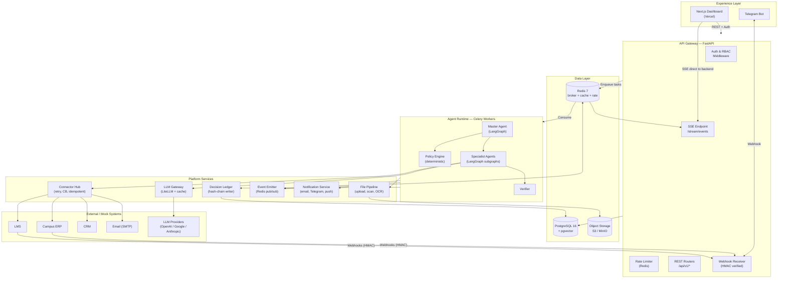
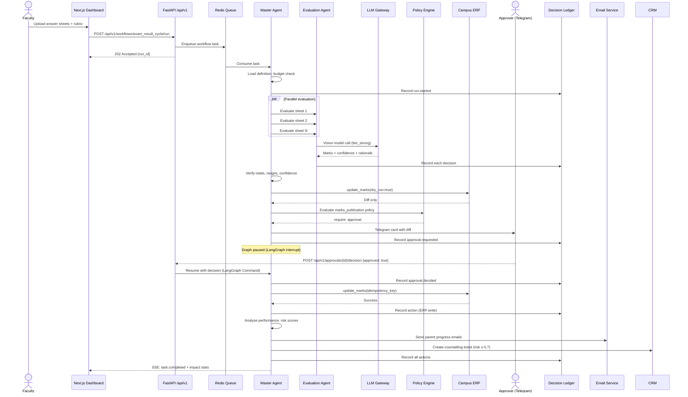
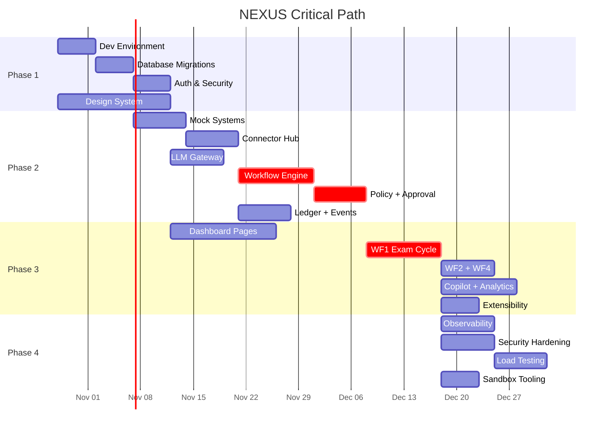
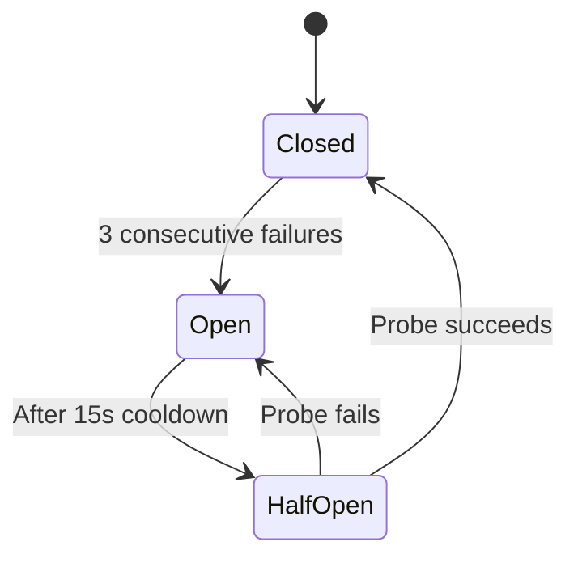

# NEXUS — Production Development Plan

> **Version:** 1.0 · **Date:** 2026-10-23 · **Status:** Draft for approval

---

## Table of Contents

1. [Executive Summary and Scope](#1-executive-summary-and-scope)
2. [Gap Analysis](#2-gap-analysis)
3. [Target Architecture](#3-target-architecture)
4. [Non-Functional Requirements](#4-non-functional-requirements)
5. [Work Breakdown Structure](#5-work-breakdown-structure)
6. [Phased Roadmap](#6-phased-roadmap)
7. [Detailed Subsystem Designs](#7-detailed-subsystem-designs)
8. [Testing and Quality Strategy](#8-testing-and-quality-strategy)
9. [CI/CD, Environments and Deployment](#9-cicd-environments-and-deployment)
10. [Security and Privacy Plan](#10-security-and-privacy-plan)
11. [Observability and Operations](#11-observability-and-operations)
12. [Risk Register](#12-risk-register)
13. [Team Structure and Timeline](#13-team-structure-and-timeline)
14. [Repository Structure and Coding Standards](#14-repository-structure-and-coding-standards)
15. [Open Questions](#15-open-questions)
16. [Design System and UI Plan](#16-design-system-and-ui-plan)

---

## 1. Executive Summary and Scope

### What NEXUS Is

NEXUS is an agentic AI workflow automation platform that orchestrates intelligent agents across connected enterprise systems (ERP, LMS, CRM, email). It features policy-driven human-in-the-loop approvals, a tamper-evident decision ledger, and impact analytics. The first deployment pack is **NEXUS Campus** (education management).

### In Scope (Production v1)

- **Core Platform:** Workflow engine (YAML→LangGraph compiler), Master Agent orchestration, LLM Gateway with tiered routing, Connector Hub with dry-run/idempotency/circuit breakers, Policy & Approval Engine, Decision Ledger with hash-chain verification, SSE event streaming.
- **Campus Pack:** WF1 Exam Result Cycle, WF2 Assignment Cycle, WF3 Admin Copilot, WF4 Security Incident Response. WF5 (Timetable) and WF6 (Question Papers) are Phase 3.
- **Extensibility Proof:** HR Leave Approval workflow running from config.
- **Frontend:** One unified Next.js dashboard (role-aware sidebar, command palette, slide-over Copilot) with Mission Control, Agent Map, Run Detail with Decision Replay, Approval Inbox, Connected Systems, Workflow Studio, Audit Explorer, Impact Analytics, Token & Cost, Security Center, Template Gallery, Settings, Login.
- **Infrastructure:** Docker Compose local dev, CI/CD pipelines, containerised production deployment, PostgreSQL + Redis + MinIO/S3, database migrations with rollback.
- **Mock Enterprise Systems:** Campus ERP, LMS, CRM (as separate FastAPI services with their own databases) — these serve as sandbox/development systems. In production, real connector adapters replace them.
- **Observability:** Structured logging, Sentry error tracking, metrics, distributed tracing stubs.
- **Security:** RBAC, JWT auth with MFA, secrets management, encryption, prompt injection defences, rate limiting.
- **Design System:** Complete token-based design system, component library built on shadcn/ui primitives with custom theming, Storybook documentation.

### Out of Scope (v1)

- Real ERP integrations (Moodle, Google Classroom, SAP, HubSpot) — only the connector interface and mock adapters.
- Multi-tenancy / SaaS billing.
- Student/parent login portals.
- Mobile native app (responsive web only).
- Visual drag-and-drop workflow builder (future; Workflow Studio is read-only + autonomy dial in v1).
- Dark theme (design tokens planned; implementation is Phase 4+).
- Predictive analytics / ML models beyond LLM calls.
- MCP connector marketplace.

### Assumptions

1. A 4-person team (1 backend/agents, 1 backend/platform, 1 frontend/design, 1 DevOps/QA) working full-time.
2. LLM provider access (OpenAI, Google, Anthropic) with API keys. Provider-agnostic via LiteLLM.
3. PostgreSQL 16+ with pgvector extension available.
4. Vercel account for frontend hosting; VPS or Railway/Render for backend.
5. Telegram Bot API token available for approval channel.
6. India's DPDP Act 2023 compliance is advisory — full legal review needed before processing real student data.
7. project.md section 21 (Demo Plan) features become sandbox/staging tooling behind feature flags.

---

## 2. Gap Analysis

### Demo-Grade vs Production-Grade Conflicts

| # | Area | project.md Approach (§) | Production Issue | Resolution |
|---|------|------------------------|-----------------|------------|
| G1 | **Demo Mode** (§12, §21) | Pre-recorded LLM responses for scripted inputs | Useful for testing/staging but must never leak into production | Keep as `FEATURE_FLAG: sandbox_demo_mode`, OFF in prod. Add admin-only toggle. Record responses become golden test fixtures. |
| G2 | **Chaos Switch** (§5.7) | `POST /_admin/chaos` on mock systems | Useful for resilience testing but dangerous if exposed | Keep behind `FEATURE_FLAG: sandbox_chaos_mode`, OFF in prod. Require admin auth. Mock systems should not exist in production — real connector adapters replace them. |
| G3 | **Presenter Mode** (§17.3) | Hides panels, enlarges fonts | Not a production concern | Keep as a display preference in Settings, not a feature flag. |
| G4 | **Seed Data & Reset** (§5.6, §21) | `make seed`, `make reset` wipe and restore | Catastrophic in production | Seed scripts only run in `development` and `staging` environments. `make reset` disabled in `production` via env check. |
| G5 | **Story Characters** (§5.6) | Riya Patel, Karan Mehta as scripted demo data | Useful for testing/demos but not for prod | Keep in seed data only. No hard-coded references in business logic. |
| G6 | **Dark theme default** (§17.3) | "Dark theme with one accent colour" | User request specifies **LIGHT theme primary** | Light theme is primary (oat/cream palette). Dark theme is Phase 4. |
| G7 | **Ledger advisory lock** (§26.3) | `pg_advisory_xact_lock` for serialisation | Works but bottlenecks under high concurrency | Use `SELECT ... FOR UPDATE SKIP LOCKED` on a ledger sequence counter table for better throughput. Advisory lock as fallback. Add partitioning plan for ledger table. |
| G8 | **SSE on Vercel** (§11.1) | "Browser opens SSE directly to the backend host" | Correctly identifies Vercel limitation. Need explicit architecture for SSE proxy or direct backend connection | Frontend SSE connects directly to backend API host (not Vercel). Auth via short-lived token in query string. CORS configured explicitly. |
| G9 | **Auth** (§18) | JWT with refresh rotation, MFA for admins | No session management, no token revocation, no CSRF protection mentioned | Add: Redis-backed token blacklist for logout/revocation, CSRF tokens for state-changing requests, session activity logging, account lockout after N failures. |
| G10 | **Error handling** (§8.2) | "retry, switch model tier, escalate" | No dead-letter queue, no poison message handling, no structured error taxonomy | Add: DLQ for failed tasks after max retries, error classification (transient/permanent/rate-limit), structured error responses with correlation IDs. |
| G11 | **Database** (§15) | Single Postgres for platform + separate for mocks | No migration strategy, no indexing plan, no connection pooling, no backup/restore procedure | Add: Alembic migrations with rollback scripts, index plan per table, PgBouncer for connection pooling, automated daily backups with tested restore, WAL archiving for RPO < 1h. |
| G12 | **Observability** (§11, §19) | "Sentry (errors), structured JSON logs" | Minimal — no metrics, no tracing, no dashboards, no alerting, no SLOs | Add: OpenTelemetry for traces, Prometheus-compatible metrics export, Grafana dashboards, PagerDuty/Opsgenie alerting, defined SLOs per service. |
| G13 | **Rate limiting** (§18) | Mentioned but not designed | No implementation detail | Add: Redis-based rate limiting middleware (token bucket), per-user and per-IP limits, per-endpoint configuration. |
| G14 | **Input validation** (§18) | Pydantic for API, `simpleeval` for policies | No file upload validation, no size limits, no malware scanning | Add: File type whitelist, max upload size (50MB), virus scanning for uploads (ClamAV or cloud API), Pydantic strict mode. |
| G15 | **Backup & recovery** (§19) | "daily backup" mentioned | No tested restore procedure, no RPO/RTO defined | Define RPO < 1h, RTO < 4h. Daily pg_dump + WAL archiving. Monthly restore drills. Document runbook. |
| G16 | **API versioning** (§16) | No versioning mentioned | Breaking changes will affect consumers | Add `/api/v1/` prefix. Version in URL path. Deprecation headers. |
| G17 | **Prompt injection** (§18) | "wrapped as untrusted data" | Good principle but no implementation detail | Add: System/user message separation, input sanitisation layer in LLM Gateway, output filtering, canary token detection. |
| G18 | **Concurrency** (§26.5) | Single Celery task for workflow | No handling of concurrent runs modifying same data | Add: Optimistic locking on shared resources (marks, grades), conflict detection in connectors. |
| G19 | **PII handling** (§12) | "PII minimiser: replace names and emails" | One-way pseudonymisation is lossy | Add: Reversible pseudonymisation with a secure mapping table, data classification tags, retention policies. |
| G20 | **Webhook security** (§5, §16) | Inbound webhooks from mock systems | No signature verification, no replay protection | Add: HMAC signature verification on all inbound webhooks, timestamp validation (±5 min), idempotency on webhook processing. |

---

## 3. Target Architecture

### 3.1 High-Level Architecture



### 3.2 Key Architecture Improvements over project.md

| Improvement | Rationale |
|------------|-----------|
| **API versioning** (`/api/v1/`) | Enables non-breaking API evolution |
| **Rate limiting middleware** (Redis token bucket) | OWASP requirement; prevents abuse |
| **Dead-letter queue** (Celery DLQ + `failed_tasks` table) | Zero data loss on permanent failures |
| **Connection pooling** (PgBouncer) | Handles connection exhaustion under load |
| **Webhook HMAC verification** | Prevents spoofed inbound events |
| **Token blacklist** (Redis set) | Enables secure logout and token revocation |
| **File processing pipeline** (type check → virus scan → OCR) | Prevents malicious uploads |
| **Structured error taxonomy** | Enables automated retry decisions |
| **OpenTelemetry instrumentation** | Production-grade distributed tracing |
| **Ledger table partitioning** (by month) | Prevents unbounded table growth |
| **Reversible pseudonymisation** | Maintains data utility while protecting PII |

### 3.3 Technology Stack (Final)

| Layer | Technology | Version | Justification |
|-------|-----------|---------|---------------|
| Frontend framework | Next.js (App Router) | 15.x | SSR, file-based routing, React Server Components |
| UI primitives | shadcn/ui + Radix | latest | Accessible primitives, fully customisable |
| Styling | Tailwind CSS | 4.x | Token-based design system, JIT compilation |
| Charts | Recharts | 2.x | React-native charting, good for dashboards |
| Graph visualisation | React Flow | 12.x | Agent map, workflow studio |
| Animation | Framer Motion | 11.x | Declarative animations, `prefers-reduced-motion` |
| State management | TanStack Query + Zustand | 5.x / 5.x | Server state + minimal client state |
| Backend API | FastAPI | 0.115+ | Async, Pydantic v2, auto OpenAPI docs |
| ORM | SQLAlchemy 2 | 2.0+ | Async support, type safety |
| Migrations | Alembic | 1.14+ | Reversible migrations, branching support |
| Agent framework | LangGraph | 0.3+ | Durable state, checkpoints, human interrupts |
| Task queue | Celery | 5.4+ | Mature, Redis broker, beat scheduler |
| LLM routing | LiteLLM | 1.x | Provider-agnostic, 100+ model support |
| Database | PostgreSQL | 16+ | pgvector, advisory locks, partitioning |
| Cache / broker | Redis | 7+ | Celery broker, pub/sub, rate limiting, caching |
| Object storage | MinIO (dev) / S3 (prod) | latest | S3-compatible API |
| Constraint solver | Google OR-Tools | 9.x | Deterministic timetable generation |
| Document processing | PyMuPDF + Pillow | latest | PDF parsing, image processing |
| Email (dev) | Mailpit | latest | Local SMTP + UI |
| Email (prod) | Resend / SES | latest | Reliable delivery, templates |
| Error tracking | Sentry | latest | Error aggregation, release tracking |
| Observability | OpenTelemetry + Prometheus | latest | Traces, metrics, vendor-neutral |
| Password hashing | Argon2 (argon2-cffi) | latest | Memory-hard, OWASP recommended |
| Container | Docker + Docker Compose | latest | Local dev + production deployment |
| Frontend hosting | Vercel | latest | Edge CDN, preview deployments |
| Backend hosting | VPS with Docker Compose + Caddy | — | Long-lived connections, SSE support |
| IaC | Docker Compose (v1), with Terraform stubs | — | Reproducible infrastructure |

### 3.4 Data Flow — Exam Result Workflow



---

## 4. Non-Functional Requirements

| Category | Metric | Target | Measurement |
|----------|--------|--------|-------------|
| **Latency** | API response (p95) | < 200ms (reads), < 500ms (writes) | OpenTelemetry histogram |
| **Latency** | Dashboard page load (LCP) | < 2.5s | Vercel Analytics |
| **Latency** | SSE event delivery | < 500ms from worker emit to browser | Custom timing metric |
| **Throughput** | Concurrent workflow runs | 50 simultaneous | Load test (Locust) |
| **Throughput** | API requests/second | 500 rps sustained | Load test |
| **Availability** | Platform uptime | 99.5% (monthly) | Uptime monitor |
| **RPO** | Data loss tolerance | < 1 hour | WAL archiving + hourly pg_dump |
| **RTO** | Recovery time | < 4 hours | Documented runbook, monthly drill |
| **Cost** | Per workflow run (LLM) | < $0.50 for exam cycle (30 sheets) | Token tracking in `llm_calls` table |
| **Cost** | Monthly infrastructure | < $200 for staging | Cloud billing alerts |
| **Security** | OWASP ASVS | Level 2 compliance | Annual audit checklist |
| **Accessibility** | WCAG compliance | 2.2 AA | axe-core CI + manual audit |
| **Test coverage** | Backend unit tests | ≥ 80% line coverage | pytest-cov |
| **Test coverage** | Frontend component tests | ≥ 70% | Vitest |
| **Test coverage** | E2E critical paths | 100% of P0 flows | Playwright |
| **LLM accuracy** | Exam marking (vs faculty) | ≥ 85% agreement rate | Golden dataset evaluation |
| **LLM accuracy** | Prompt regression | 0 regressions per release | Prompt eval suite |

---

## 5. Work Breakdown Structure

### Epic Overview

| Epic ID | Epic Name | Phase | Owner Role |
|---------|-----------|-------|------------|
| EPIC-01 | Foundation & Infrastructure | 1 | Platform/DevOps |
| EPIC-02 | Design System & Component Library | 1 | Frontend/Design |
| EPIC-03 | Database & Data Layer | 1 | Backend |
| EPIC-04 | Auth, RBAC & Security Baseline | 1 | Platform |
| EPIC-05 | Connector Hub | 2 | Backend |
| EPIC-06 | LLM Gateway | 2 | AI/ML |
| EPIC-07 | Workflow Engine & Master Agent | 2 | AI/ML |
| EPIC-08 | Policy & Approval Engine | 2 | Backend |
| EPIC-09 | Decision Ledger | 2 | Backend |
| EPIC-10 | Event Streaming & SSE | 2 | Platform |
| EPIC-11 | Mock Enterprise Systems | 2 | Backend |
| EPIC-12 | Dashboard Shell & Navigation | 3 | Frontend |
| EPIC-13 | Mission Control & Agent Map | 3 | Frontend |
| EPIC-14 | Approval UI & Workflow Views | 3 | Frontend |
| EPIC-15 | WF1: Exam Result Cycle | 3 | AI/ML + Backend |
| EPIC-16 | WF2: Assignment Cycle | 3 | Backend |
| EPIC-17 | WF3: Admin Copilot | 3 | AI/ML |
| EPIC-18 | WF4: Security Incident Response | 3 | Backend |
| EPIC-19 | Audit Explorer & Governance UI | 3 | Frontend |
| EPIC-20 | Impact Analytics & Cost UI | 3 | Frontend |
| EPIC-21 | Notification Service (Email + Telegram) | 2 | Backend |
| EPIC-22 | Extensibility: HR Leave Template | 3 | Backend |
| EPIC-23 | Observability & Monitoring | 4 | Platform/DevOps |
| EPIC-24 | Security Hardening | 4 | Platform |
| EPIC-25 | Performance & Load Testing | 4 | QA |
| EPIC-26 | WF5: Timetable Generation | 5 | AI/ML |
| EPIC-27 | WF6: Question Paper Generation | 5 | AI/ML |
| EPIC-28 | Sandbox/Demo Tooling | 4 | Platform |

---

### EPIC-01: Foundation & Infrastructure

| Task ID | Description | Acceptance Criteria | Dependencies | Size | Owner |
|---------|-------------|-------------------|--------------|------|-------|
| EPIC-01-T01 | Initialise monorepo with `frontend/`, `backend/`, `mock-systems/`, `docs/`, `design/` structure | Directories exist, README.md with setup instructions | — | S | Platform |
| EPIC-01-T02 | Set up Docker Compose with PostgreSQL 16 (pgvector), Redis 7, MinIO, Mailpit | `docker compose up` starts all services, health checks pass | T01 | M | Platform |
| EPIC-01-T03 | Configure backend FastAPI skeleton with config, middleware, health endpoint | `GET /health` returns 200 with service versions | T02 | S | Platform |
| EPIC-01-T04 | Set up Alembic migration framework with initial schema | `alembic upgrade head` creates empty DB, `alembic downgrade -1` rolls back cleanly | T03 | S | Backend |
| EPIC-01-T05 | Configure PgBouncer for connection pooling | Backend connects through PgBouncer, 50 connection limit verified | T02 | S | Platform |
| EPIC-01-T06 | Set up pre-commit hooks (Ruff, Black, mypy, isort for Python; ESLint, Prettier for TS) | `pre-commit run --all` passes on empty project | T01 | S | Platform |
| EPIC-01-T07 | Initialise Next.js 15 project with App Router, Tailwind 4, TypeScript strict | `npm run dev` shows blank page, no TS errors | T01 | S | Frontend |
| EPIC-01-T08 | Set up Makefile with `up`, `down`, `seed`, `migrate`, `test`, `lint` targets | Each make target works | T02 | S | Platform |
| EPIC-01-T09 | Configure GitHub Actions CI: lint, type-check, unit tests on PR | PR triggers CI, green/red status shown | T06, T07 | M | Platform |
| EPIC-01-T10 | Set up `.env.example` with all required environment variables documented | All vars listed, no secrets committed | T03 | S | Platform |
| EPIC-01-T11 | Configure Sentry for backend and frontend error tracking | Errors appear in Sentry dashboard | T03, T07 | S | Platform |

---

### EPIC-02: Design System & Component Library

| Task ID | Description | Acceptance Criteria | Dependencies | Size | Owner |
|---------|-------------|-------------------|--------------|------|-------|
| EPIC-02-T01 | Define design tokens (CSS custom properties + Tailwind theme): colours, typography, spacing, radius, elevation, motion | Token file exists in `design/tokens.css` and `tailwind.config.ts` extends theme | — | M | Design |
| EPIC-02-T02 | Set up typography: Source Serif 4 (headings), Inter (body), JetBrains Mono (monospace) via `next/font` | Fonts load on page, type scale renders correctly | T01 (EPIC-01-T07) | S | Design |
| EPIC-02-T03 | Install and configure shadcn/ui with custom theme overriding default colours | `components.json` exists, Button renders with teal primary | T01 (EPIC-01-T07) | S | Frontend |
| EPIC-02-T04 | Build base components: Button, Badge, Card, Input, Select, Textarea, Tooltip, Dialog, Dropdown, Sheet | All components render with correct theme, all states (hover, focus, disabled, loading) | T03 | L | Frontend |
| EPIC-02-T05 | Build data components: DataTable (sortable, filterable, paginated), Stat Card, Progress Bar, Timeline | Components render with sample data, responsive | T04 | L | Frontend |
| EPIC-02-T06 | Build status components: StatusBadge (done/running/waiting/failed/warning), Risk Badge, Confidence Indicator | Each status has distinct colour + icon, not colour-only | T04 | M | Frontend |
| EPIC-02-T07 | Build layout components: AppShell (sidebar + header + content), CommandPalette (Ctrl+K), CopilotSheet (slide-over) | Layout renders, sidebar collapses, command palette opens | T04 | L | Frontend |
| EPIC-02-T08 | Build feedback components: Toast, Skeleton loader, Empty state, Error boundary, Loading spinner | Each state renders correctly | T04 | M | Frontend |
| EPIC-02-T09 | Set up Storybook with all components documented | `npm run storybook` shows all components with controls | T04-T08 | M | Frontend |
| EPIC-02-T10 | Configure Chromatic or Percy for visual regression testing | Visual diff captured on PR, baseline established | T09 | S | QA |
| EPIC-02-T11 | Accessibility audit of all components: axe-core + keyboard navigation test | Zero critical/serious axe violations, all components keyboard-navigable | T04-T08 | M | QA |
| EPIC-02-T12 | Define icon set (Lucide) and illustration style guide | Icon usage documented, consistent sizing (16/20/24px) | T01 | S | Design |
| EPIC-02-T13 | Build chart theme (Recharts): consistent colours, axes, tooltips matching design system | Sample chart renders with correct theme | T01 | S | Design |

---

### EPIC-03: Database & Data Layer

| Task ID | Description | Acceptance Criteria | Dependencies | Size | Owner |
|---------|-------------|-------------------|--------------|------|-------|
| EPIC-03-T01 | Create Alembic migration for `users`, `roles`, `permissions` tables with indexes | Tables created, indexes verified with `EXPLAIN`, rollback works | EPIC-01-T04 | S | Backend |
| EPIC-03-T02 | Create migration for `agents`, `workflow_definitions`, `workflow_runs`, `tasks`, `task_events` | Tables created with correct constraints, FK relationships | T01 | M | Backend |
| EPIC-03-T03 | Create migration for `audit_ledger` with append-only constraints, partitioning by month | `REVOKE UPDATE, DELETE` on ledger table, partition function works | T01 | M | Backend |
| EPIC-03-T04 | Create migration for `approval_requests`, `approval_decisions` | Tables with FK to runs and users, indexes on status + deadline | T02 | S | Backend |
| EPIC-03-T05 | Create migration for `llm_calls`, `token_budgets`, `model_tiers` | Cost tracking tables with indexes on task_id, agent_id, ts | T02 | S | Backend |
| EPIC-03-T06 | Create migration for `connectors`, `connector_calls` | Circuit state tracking, latency indexes | T02 | S | Backend |
| EPIC-03-T07 | Create migration for `policies` table (versioned YAML storage) | Policy CRUD with version history | T01 | S | Backend |
| EPIC-03-T08 | Create migration for `security_events`, `blocked_entities`, `login_attempts` | Security tables with TTL indexes | T01 | S | Backend |
| EPIC-03-T09 | Create migration for `documents`, `chunks` (pgvector), `question_bank` | Vector embeddings work, similarity search verified | T01 | M | Backend |
| EPIC-03-T10 | Create migration for `notifications` table | Notification status tracking | T01 | S | Backend |
| EPIC-03-T11 | Create SQLAlchemy 2 ORM models for all tables | Models match migrations, type annotations complete | T01-T10 | L | Backend |
| EPIC-03-T12 | Create database seed script (Faker, locale `en_IN`) with story characters | `make seed` populates all tables with realistic data | T11 | M | Backend |
| EPIC-03-T13 | Set up automated daily backup script (pg_dump) with restore verification | Backup runs, restore tested, documented in runbook | T02 | M | Platform |
| EPIC-03-T14 | Create index plan document with EXPLAIN ANALYZE results for key queries | All key queries use indexes, no sequential scans on large tables | T11 | M | Backend |

---

### EPIC-04: Auth, RBAC & Security Baseline

| Task ID | Description | Acceptance Criteria | Dependencies | Size | Owner |
|---------|-------------|-------------------|--------------|------|-------|
| EPIC-04-T01 | Implement JWT auth with access + refresh token rotation (Argon2 password hashing) | Login returns tokens, refresh rotates, expired tokens rejected | EPIC-03-T01 | M | Platform |
| EPIC-04-T02 | Implement RBAC middleware with role-permission matrix (admin, faculty, approver, operator) | Endpoints enforce role checks, 403 on unauthorised access | T01 | M | Platform |
| EPIC-04-T03 | Implement MFA (TOTP) for admin and approver roles | MFA setup, verification, recovery codes, bypass for dev env | T01 | M | Platform |
| EPIC-04-T04 | Implement Redis-backed token blacklist for logout/revocation | Logout invalidates token, blacklisted token returns 401 | T01, EPIC-01-T02 | S | Platform |
| EPIC-04-T05 | Implement rate limiting middleware (Redis token bucket) | Per-user: 100 req/min, per-IP: 200 req/min, per-endpoint configurable | EPIC-01-T02 | M | Platform |
| EPIC-04-T06 | Add security headers middleware (HSTS, CSP, X-Frame-Options, etc.) | All headers present, verified with securityheaders.com | EPIC-01-T03 | S | Platform |
| EPIC-04-T07 | Implement CORS configuration (explicit origins, credentials) | Frontend origin allowed, wildcard blocked | EPIC-01-T03 | S | Platform |
| EPIC-04-T08 | Set up secrets management (environment variables with `.env` validation) | App fails to start if required secrets missing | EPIC-01-T10 | S | Platform |
| EPIC-04-T09 | Implement account lockout after 5 failed login attempts (15 min cooldown) | Account locks, admin can unlock, event logged | T01, EPIC-03-T08 | S | Platform |
| EPIC-04-T10 | Implement input validation middleware (request size limits, content-type enforcement) | Oversized requests rejected (413), wrong content-type rejected (415) | EPIC-01-T03 | S | Platform |

---

### EPIC-05: Connector Hub

| Task ID | Description | Acceptance Criteria | Dependencies | Size | Owner |
|---------|-------------|-------------------|--------------|------|-------|
| EPIC-05-T01 | Implement `Connector` protocol and `ConnectorResult` base classes | Protocol defined with type hints, documented | EPIC-01-T03 | S | Backend |
| EPIC-05-T02 | Implement retry logic with exponential backoff + jitter (tenacity) | 3 retries, configurable, jitter prevents thundering herd | T01 | S | Backend |
| EPIC-05-T03 | Implement circuit breaker (states: closed, open, half-open) | Opens after 3 failures, half-open probe after 15s, auto-recovers | T01 | M | Backend |
| EPIC-05-T04 | Implement idempotency key checking (DB-backed) | Duplicate key returns cached result, no double-write | T01, EPIC-03-T06 | M | Backend |
| EPIC-05-T05 | Implement dry-run diff generation (structured before/after) | `dry_run=True` returns diff without side effects | T01 | M | Backend |
| EPIC-05-T06 | Implement connector registry with health check aggregation | All connectors registered, health endpoint returns status map | T01-T05 | S | Backend |
| EPIC-05-T07 | Implement ERP connector adapter (all operations from §6.3) | `get_students`, `get_marks`, `update_marks`, `soft_delete_student` work | T06 | M | Backend |
| EPIC-05-T08 | Implement LMS connector adapter | `get_submissions`, `update_grade`, `list_overdue` work | T06 | M | Backend |
| EPIC-05-T09 | Implement CRM connector adapter | `create_ticket`, `add_note`, `get_contact` work | T06 | S | Backend |
| EPIC-05-T10 | Implement email connector adapter (SMTP + Resend) | Emails sent via Mailpit (dev) and Resend (prod) | T06 | S | Backend |
| EPIC-05-T11 | Implement Telegram connector adapter | `send_approval_card`, `send_alert` work | T06 | S | Backend |
| EPIC-05-T12 | Implement storage connector adapter (MinIO/S3) | `put_object`, `get_signed_url` work | T06 | S | Backend |
| EPIC-05-T13 | Write unit tests for connector hub (mock external calls) | ≥ 90% coverage on hub logic, all error paths tested | T01-T12 | M | QA |
| EPIC-05-T14 | Write integration tests for each connector against mock systems | End-to-end connector calls succeed against running mock services | T07-T12, EPIC-11 | M | QA |

---

### EPIC-06: LLM Gateway

| Task ID | Description | Acceptance Criteria | Dependencies | Size | Owner |
|---------|-------------|-------------------|--------------|------|-------|
| EPIC-06-T01 | Implement LLM Gateway core: tier selection, provider routing via LiteLLM | Calls route to correct model based on tier config | EPIC-01-T03 | M | AI/ML |
| EPIC-06-T02 | Implement budget guard (global, workflow, agent, task level) | Over-budget calls downgrade tier or raise `BudgetExceeded` | T01, EPIC-03-T05 | M | AI/ML |
| EPIC-06-T03 | Implement response cache (Redis, hash of model + prompt) | Identical calls return cached result, cache TTL configurable | T01, EPIC-01-T02 | S | AI/ML |
| EPIC-06-T04 | Implement PII pseudonymisation (reversible mapping table) | Names/emails replaced with IDs before LLM call, restored after | T01, EPIC-03-T01 | M | AI/ML |
| EPIC-06-T05 | Implement JSON schema validation with one repair retry | Invalid JSON triggers retry with schema hint, still invalid raises error | T01 | S | AI/ML |
| EPIC-06-T06 | Implement usage logging (tokens, cost, latency per call) | Every call creates `llm_calls` record, SSE event emitted | T01, EPIC-03-T05, EPIC-10 | S | AI/ML |
| EPIC-06-T07 | Implement prompt injection defence layer (system/user separation, input sanitisation) | Injected instructions in data ignored, canary tokens detected | T01 | M | AI/ML |
| EPIC-06-T08 | Implement demo replay mode (recorded responses) behind feature flag | `SANDBOX_DEMO_MODE=true` serves recorded responses, pipeline still runs | T01, T03 | S | AI/ML |
| EPIC-06-T09 | Write unit tests for gateway (mock LLM providers) | All paths tested: cache hit, budget exceeded, schema failure, PII stripping | T01-T08 | M | QA |
| EPIC-06-T10 | Configure model tier settings table with pricing | Admin can update tier→model mapping and pricing via API | T01, EPIC-03-T05 | S | AI/ML |

---

### EPIC-07: Workflow Engine & Master Agent

| Task ID | Description | Acceptance Criteria | Dependencies | Size | Owner |
|---------|-------------|-------------------|--------------|------|-------|
| EPIC-07-T01 | Implement YAML workflow definition parser with Pydantic validation | Parses exam_result_cycle.yaml, validates all step types | EPIC-01-T03 | M | AI/ML |
| EPIC-07-T02 | Implement YAML→LangGraph compiler (all step types: agent, connector, approval, parallel, verify, branch, notify) | Compiled graph matches definition structure, conditional edges work | T01 | L | AI/ML |
| EPIC-07-T03 | Implement `RunState` TypedDict with all fields from §8.3 | State persists across checkpoints, all fields accessible | T02 | S | AI/ML |
| EPIC-07-T04 | Set up LangGraph PostgresSaver checkpointer | Crashed worker resumes from last checkpoint | T03, EPIC-03-T02 | M | AI/ML |
| EPIC-07-T05 | Implement Master Agent: intake, plan, pre-check, dispatch, track, aggregate, finalise | Master runs a workflow end-to-end (dry run, no real connectors) | T02, T04 | L | AI/ML |
| EPIC-07-T06 | Implement parallel fan-out (LangGraph `Send` or Celery sub-tasks with join) | Parallel steps execute concurrently, results aggregated | T05 | M | AI/ML |
| EPIC-07-T07 | Implement approval node with `interrupt()` and resume via `Command` | Graph pauses at approval, resumes when API receives decision | T05, EPIC-08 | M | AI/ML |
| EPIC-07-T08 | Implement branch/conditional routing (`when:` expressions) | Conditional edges work with `simpleeval` | T05 | S | AI/ML |
| EPIC-07-T09 | Implement autonomy dial (assist/supervised/autonomous) with live switching | Dial change takes effect on next policy evaluation | T05, EPIC-08 | S | AI/ML |
| EPIC-07-T10 | Implement Celery task wrappers (queue routing: ai_heavy, ai_light, connectors, email, security) | Tasks route to correct queues, concurrency limits enforced | T05, EPIC-01-T02 | M | AI/ML |
| EPIC-07-T11 | Implement failure handling: retry, model tier downgrade, escalation, DLQ | Failed tasks retry 3x, then DLQ with admin notification | T05, T10 | M | AI/ML |
| EPIC-07-T12 | Implement Decision Replay (checkpoint-by-checkpoint state retrieval) | API returns ordered checkpoints with inputs/outputs/decisions for a run | T04 | M | AI/ML |
| EPIC-07-T13 | Implement ad-hoc request planning (Copilot → tool-constrained plan → validate → execute) | Chat request generates valid plan using only registered tools | T05, EPIC-17 | L | AI/ML |
| EPIC-07-T14 | Write workflow definition files: exam_result_cycle.yaml, assignment_cycle.yaml, leave_request.yaml, security_incident.yaml | All YAML files parse and compile successfully | T01 | M | AI/ML |
| EPIC-07-T15 | Write integration tests for workflow engine (end-to-end with mock connectors) | Exam cycle runs from trigger to completion with correct ledger entries | T05-T11, EPIC-05, EPIC-06 | L | QA |

---

### EPIC-08: Policy & Approval Engine

| Task ID | Description | Acceptance Criteria | Dependencies | Size | Owner |
|---------|-------------|-------------------|--------------|------|-------|
| EPIC-08-T01 | Implement policy rule evaluator with `simpleeval` (safe, no `eval`) | Evaluates conditions correctly, rejects unsafe expressions | EPIC-01-T03 | M | Backend |
| EPIC-08-T02 | Implement risk classification (connector risk × context × autonomy level) | Risk levels computed correctly for all scenarios | T01 | S | Backend |
| EPIC-08-T03 | Implement approval routing (auto/notify/approval/dual_approval) | Correct decision for each risk level + autonomy combination | T01, T02 | M | Backend |
| EPIC-08-T04 | Implement approval request creation with diff binding (diff_hash) | Approval bound to exact diff shown; data change invalidates approval | T03, EPIC-05-T05 | M | Backend |
| EPIC-08-T05 | Implement approval timeout and escalation (configurable per policy) | Timeout triggers escalation to next approver role | T04 | M | Backend |
| EPIC-08-T06 | Implement rejection handling (reason required, agent can re-propose) | Rejection stops step, records reason, optional retry | T03 | S | Backend |
| EPIC-08-T07 | Implement dual-approval flow (two different approvers required) | Both approvals needed for critical actions, same person blocked | T03 | M | Backend |
| EPIC-08-T08 | Implement guard: policy rule cannot lower critical below dual_approval | Invariant enforced regardless of policy YAML content | T03 | S | Backend |
| EPIC-08-T09 | Implement policy CRUD API (GET/PUT /api/v1/policies) with version history | Policies created, updated, versioned, rollback supported | T01, EPIC-03-T07 | M | Backend |
| EPIC-08-T10 | Write default policy files: marks_publication, bulk_delete, parent_communication, leave_policy | All policies parse and evaluate correctly | T01 | S | Backend |
| EPIC-08-T11 | Write unit tests for policy engine (exhaustive risk/autonomy matrix) | Every combination of risk × autonomy × policy yields correct decision | T01-T10 | M | QA |

---

### EPIC-09: Decision Ledger

| Task ID | Description | Acceptance Criteria | Dependencies | Size | Owner |
|---------|-------------|-------------------|--------------|------|-------|
| EPIC-09-T01 | Implement hash-chain ledger writer with serialisation (advisory lock or sequence counter) | Entries append with correct hash chain, concurrent appends serialised | EPIC-03-T03 | M | Backend |
| EPIC-09-T02 | Implement chain verification endpoint (`GET /api/v1/audit/verify`) | Returns `{intact: true, checked: N}` or `{intact: false, broken_at: seq}` | T01 | M | Backend |
| EPIC-09-T03 | Implement canonical JSON serialisation (deterministic for hash) | Numeric values stored as strings/integers, hash reproducible | T01 | S | Backend |
| EPIC-09-T04 | Implement ledger query API with filters (run_id, actor, type, date range) | Filtered queries return correct results, paginated | T01, EPIC-03-T03 | M | Backend |
| EPIC-09-T05 | Implement run audit export (PDF and JSON formats) | Export contains full run timeline with decisions and approvals | T04 | M | Backend |
| EPIC-09-T06 | Implement ledger table partitioning (by month) with automatic partition creation | Old partitions archivable, queries use partition pruning | T01 | M | Platform |
| EPIC-09-T07 | Write integration test: tamper detection (modify row, verify reports broken_at) | Tampered chain detected at correct sequence number | T02 | S | QA |

---

### EPIC-10: Event Streaming & SSE

| Task ID | Description | Acceptance Criteria | Dependencies | Size | Owner |
|---------|-------------|-------------------|--------------|------|-------|
| EPIC-10-T01 | Implement event emitter (worker → Redis pub/sub) | Events published to `nexus.events` channel | EPIC-01-T02 | S | Platform |
| EPIC-10-T02 | Implement SSE endpoint with auth (short-lived token in query string) | Browser receives events in real-time, auth verified | T01, EPIC-04-T01 | M | Platform |
| EPIC-10-T03 | Implement event filtering (by run_id, event_type, user role) | Users only receive events they're authorised to see | T02, EPIC-04-T02 | M | Platform |
| EPIC-10-T04 | Implement frontend SSE hook (`useNexusEvents`) with reconnection logic | Hook auto-reconnects on disconnect, buffers events | T02, EPIC-01-T07 | M | Frontend |
| EPIC-10-T05 | Define event schema for all event types (TypedDict on backend, TypeScript types on frontend) | Type-safe events on both ends | T01 | S | Backend |

---

### EPIC-11: Mock Enterprise Systems

| Task ID | Description | Acceptance Criteria | Dependencies | Size | Owner |
|---------|-------------|-------------------|--------------|------|-------|
| EPIC-11-T01 | Implement Campus ERP service (FastAPI + `erp_db` + API key auth) | All endpoints from §5.1 work, health check passes | EPIC-01-T02 | L | Backend |
| EPIC-11-T02 | Implement LMS service (FastAPI + `lms_db`) | All endpoints from §5.2 work, webhooks fire | EPIC-01-T02 | M | Backend |
| EPIC-11-T03 | Implement CRM service (FastAPI + `crm_db` + Kanban UI) | Tickets CRUD, Kanban board renders | EPIC-01-T02 | M | Backend |
| EPIC-11-T04 | Implement webhook outbound (ERP: marks.updated, LMS: assignment.submitted, assignment.overdue) | Webhooks fire on data changes, HMAC signed | T01, T02 | M | Backend |
| EPIC-11-T05 | Implement chaos switch (`POST /_admin/chaos`) behind feature flag | Outage/latency/error modes work, auto-recover after duration | T01, T02, T03 | S | Backend |
| EPIC-11-T06 | Implement seed data (Faker `en_IN`) for all mock systems | `make seed` populates all systems with realistic data | T01, T02, T03 | M | Backend |
| EPIC-11-T07 | Implement simple UIs for each mock system (ERP: students + marks, LMS: courses, CRM: Kanban) | Each system has a standalone web UI showing its data | T01, T02, T03 | M | Frontend |

---

### EPIC-12 through EPIC-28

*(Task breakdowns follow the same pattern. Full details are in TASKS.md for space efficiency. Key highlights below.)*

**EPIC-12: Dashboard Shell & Navigation** — 8 tasks covering AppShell layout, role-aware sidebar, command palette (Ctrl+K), CopilotSheet, breadcrumbs, responsive layout, keyboard navigation.

**EPIC-13: Mission Control & Agent Map** — 10 tasks covering overview dashboard with live counters, React Flow agent map with status colours and animated handoffs, workflow runs table, connector health tiles, queue & worker status panel, live event feed.

**EPIC-14: Approval UI & Workflow Views** — 9 tasks covering approval inbox, approval card with diff table, Telegram approval card, Workflow Studio (read-only graph view + autonomy dial), Run detail with timeline, Decision Replay UI.

**EPIC-15: WF1 Exam Result Cycle** — 12 tasks: ingestion agent (OCR), evaluation agent (marking), analysis agent (risk scoring), verification step, full end-to-end integration, golden dataset creation, prompt evaluation suite.

**EPIC-16: WF2 Assignment Cycle** — 6 tasks: assignment agent, webhook-triggered flow, scheduled overdue detection, parent notification flow.

**EPIC-17: WF3 Admin Copilot** — 8 tasks: copilot agent, tool registration, read-only analytics queries, write confirmation cards, chat UI with charts/tables.

**EPIC-18: WF4 Security Incident Response** — 7 tasks: rule engine detection, security agent context gathering, incident summary, automated temporary response, admin notification flow.

**EPIC-19: Audit Explorer & Governance UI** — 6 tasks: searchable audit table, run timeline view, decision detail drill-down, Verify Integrity button with visual feedback, PDF/JSON export.

**EPIC-20: Impact Analytics & Cost UI** — 7 tasks: impact calculation engine, time-saved display, per-workflow comparison charts, token cost tracking, savings view (actual vs strongest-model-only), cost forecast.

**EPIC-21: Notification Service** — 5 tasks: notification dispatcher, email templates (Jinja2), Telegram bot webhook handler, notification preferences, delivery status tracking.

**EPIC-22: HR Leave Template** — 3 tasks: leave_request.yaml workflow, HR connector stub, integration test proving same-engine execution.

**EPIC-23: Observability** — 8 tasks: OpenTelemetry instrumentation, Prometheus metrics, Grafana dashboards, alerting rules, SLO definitions, health check aggregation, log aggregation.

**EPIC-24: Security Hardening** — 7 tasks: dependency scanning (Snyk/Trivy), container scanning, CSRF protection, request signing, data retention policies, consent management for student data, security audit checklist.

**EPIC-25: Performance & Load Testing** — 5 tasks: Locust load test suite, database query optimisation, API performance profiling, caching strategy review, load test targets verification.

**EPIC-26: WF5 Timetable** — 6 tasks: constraint parser, OR-Tools CP-SAT integration, conflict resolution, faculty editing grid, publish approval.

**EPIC-27: WF6 Question Papers** — 6 tasks: syllabus ingestion + pgvector embeddings, question generation, originality checking, coverage verification, export.

**EPIC-28: Sandbox/Demo Tooling** — 4 tasks: demo mode feature flag, reset endpoint, recorded LLM responses management, presenter mode.

---

## 6. Phased Roadmap

### Phase 1: Foundation (Weeks 1–3)
**Goals:** Infrastructure, database, auth, design system, component library.

| Milestone | Deliverables | Exit Criteria |
|-----------|-------------|---------------|
| M1.1: Dev Environment | Docker Compose, CI/CD, linting | `make up` + `make test` + CI green |
| M1.2: Database | All migrations, ORM models, seed data | `make seed` populates all tables |
| M1.3: Auth & Security | JWT, RBAC, MFA, rate limiting | Login flow works, role enforcement verified |
| M1.4: Design System | Tokens, components, Storybook | Storybook deployed, all components passing a11y |

**Demo-able outcome:** Storybook with full component library; Login → Dashboard shell.

---

### Phase 2: Platform Core (Weeks 4–7)
**Goals:** Connector Hub, LLM Gateway, Workflow Engine, Policy Engine, Ledger, Events, Mock Systems.

| Milestone | Deliverables | Exit Criteria |
|-----------|-------------|---------------|
| M2.1: Connectors | Hub + all adapters + mock systems | Connector calls succeed end-to-end |
| M2.2: LLM Gateway | Routing, caching, budget, PII | LLM calls route correctly, budget enforced |
| M2.3: Workflow Engine | YAML compiler, Master Agent, checkpoints | Exam workflow runs CLI end-to-end |
| M2.4: Policy + Approval | Engine, routing, timeout, escalation | Approval pauses and resumes correctly |
| M2.5: Ledger + Events | Hash chain, SSE, verification | Ledger verifies, events stream to browser |

**Demo-able outcome:** Exam workflow runs from CLI, creates ledger entries, pauses for approval, resumes.

---

### Phase 3: Full Product (Weeks 8–13)
**Goals:** All dashboard pages, all flagship workflows, Copilot, analytics, notification.

| Milestone | Deliverables | Exit Criteria |
|-----------|-------------|---------------|
| M3.1: Dashboard Pages | Mission Control, Agent Map, Approval UI, Audit | All pages render with real data |
| M3.2: WF1 Complete | Exam cycle end-to-end through UI | Faculty uploads → ERP updated → email sent → CRM ticket |
| M3.3: WF2 + WF4 | Assignment cycle + security incidents | Webhook-triggered flows work |
| M3.4: Copilot + Analytics | Chat, impact, cost, connected systems | Copilot answers queries, impact numbers shown |
| M3.5: Extensibility | HR leave template, Template Gallery | Leave workflow runs, gallery page shows packs |

**Demo-able outcome:** Full product walkthrough — all workflows, approval on phone, audit verification, impact numbers.

---

### Phase 4: Hardening (Weeks 14–17)
**Goals:** Observability, security hardening, load testing, sandbox tooling.

| Milestone | Deliverables | Exit Criteria |
|-----------|-------------|---------------|
| M4.1: Observability | Dashboards, alerting, SLOs | All SLOs have alerts firing correctly |
| M4.2: Security | Scanning, CSRF, data policies | Zero high/critical vulnerabilities |
| M4.3: Performance | Load tests pass, caching optimised | 500 rps sustained, p95 < 200ms |
| M4.4: Sandbox | Demo mode, reset, presenter | Sandbox features work behind flags |

**Demo-able outcome:** Production-ready system with dashboards, passing load tests, security scan clean.

---

### Phase 5: Advanced Workflows (Weeks 18–21)
**Goals:** Timetable generation, question paper generation, advanced features.

| Milestone | Deliverables | Exit Criteria |
|-----------|-------------|---------------|
| M5.1: Timetable | OR-Tools integration, editing grid | Valid timetable generated, conflicts resolved |
| M5.2: Question Papers | Generation, originality, export | Papers pass coverage checks, near-duplicates caught |

**Demo-able outcome:** Full Campus Pack with all 6 workflows.

---

### Critical Path



**Critical path:** Dev Environment → Database → Connector Hub → Workflow Engine → Policy Engine → WF1 Exam Cycle → All downstream features.

### Parallel Tracks

| Track | Runs alongside | Team member |
|-------|---------------|-------------|
| Design System + Components | Foundation infra | Frontend/Design |
| Mock Systems | Database migrations | Backend |
| LLM Gateway | Connector Hub | AI/ML |
| Dashboard Pages | Workflow Engine | Frontend |
| Observability + Security | Hardening phase | Platform |

### Minimum Viable Production Slice (MVPS)

The smallest shippable unit that delivers real value:

1. **Auth + RBAC** (login, role-based access)
2. **Connector Hub** (ERP adapter with dry-run + idempotency)
3. **Workflow Engine** (YAML compiler + Master Agent + checkpoints)
4. **Policy Engine** (single approval rule)
5. **Approval Inbox** (dashboard only — Telegram is Phase 2 of MVPS)
6. **Decision Ledger** (append + verify)
7. **WF1 Exam Result Cycle** (upload → evaluate → approve → write to ERP → email)
8. **Mission Control** (run status, basic agent map)
9. **Audit Explorer** (basic timeline view)

**Estimated timeline for MVPS:** 8 weeks with 4-person team.

---

## 7. Detailed Subsystem Designs

### 7.1 Workflow Compiler

**Input:** YAML workflow definition file.
**Output:** Compiled LangGraph `StateGraph` with checkpointer.

**Compilation steps:**
1. Parse YAML → Pydantic `WorkflowDefinition` model
2. Validate: all agent refs exist in registry, all connector refs exist, all policy refs exist
3. Build graph nodes for each step (type-specific node factory)
4. Wire edges: sequential by default, conditional for `branch` type, parallel for `parallel` type
5. Attach PostgresSaver checkpointer
6. Return compiled, runnable graph

**Step type → Node mapping:**

| Step Type | LangGraph Node Implementation |
|-----------|------------------------------|
| `agent` | Invokes specialist agent subgraph, routes to appropriate Celery queue based on `model_tier` |
| `connector` | Calls `ConnectorHub.call()` with params from state |
| `approval` | Evaluates policy → if approval required, calls `interrupt()` → resumes on `Command` |
| `parallel` | Uses LangGraph `Send` to fan out, collects results |
| `verify` | Runs deterministic checks (schema, ranges, totals) + optional cheap model check |
| `branch` | Conditional edge using `simpleeval` on state |
| `notify` | Dispatches to notification service |

**API contract:**

```python
# POST /api/v1/workflows/{workflow_id}/run
class WorkflowRunRequest(BaseModel):
    inputs: dict  # workflow-specific inputs
    autonomy_override: str | None = None  # assist/supervised/autonomous
    dry_run: bool = False  # validate but don't execute

class WorkflowRunResponse(BaseModel):
    run_id: UUID
    status: str  # "queued"
    estimated_steps: int

# PUT /api/v1/workflows/{workflow_id}/autonomy
class AutonomyUpdateRequest(BaseModel):
    level: Literal["assist", "supervised", "autonomous"]
```

### 7.2 Master Agent

**Responsibilities:** Intake → Plan → Pre-check → Dispatch → Track → Handle failures → Aggregate → Verify → Finalise.

**State management:** Uses `RunState` TypedDict (§8.3 of project.md). Key additions for production:

```python
class RunState(TypedDict):
    run_id: str
    workflow_id: str
    requester: dict          # {user_id, role, name}
    autonomy: str            # assist | supervised | autonomous
    inputs: dict
    plan: list[dict]         # compiled step list
    current_step: str | None
    results: dict[str, Any]  # step_id → output
    pending_approval: dict | None
    approvals: list[dict]
    errors: list[dict]
    retries: dict[str, int]  # step_id → retry count
    budget: dict             # {remaining_tokens, remaining_cost}
    impact: dict             # {measured timings per step}
    dlq_entries: list[dict]  # dead-letter entries
    started_at: str
    finished_at: str | None
```

### 7.3 LLM Gateway

**Call flow (production):**

```
call(task_id, agent, purpose, prompt, schema, tier_hint, complexity)
  1. Pick tier: agent default × complexity × config overrides
  2. Budget guard: check global → workflow → agent → task limits
     - If exceeded: downgrade tier OR raise BudgetExceeded (configurable)
  3. PII pseudonymiser: reversible mapping (names → P-XXXX, emails → E-XXXX)
     - Mapping stored in encrypted Redis with TTL
  4. Cache check: SHA-256(tier + sanitised_prompt)
     - If hit: return cached result, log as cached
  5. Demo replay check (if feature flag ON): check recorded responses
     - If hit: return recorded result
  6. Provider call via LiteLLM:
     - Timeout: 30s (small), 60s (medium), 120s (strong)
     - Retry: 2 attempts with different provider if first fails
     - Fallback: tier_strong → tier_medium if provider is down
  7. Schema validation (Pydantic):
     - If invalid: append "Return valid JSON" and retry once
     - If still invalid: raise SchemaValidationError
  8. De-pseudonymise output (restore real names/emails)
  9. Log: llm_calls table + SSE event
  10. Cache result
  11. Return LLMResult
```

### 7.4 Connector Hub

**Circuit breaker state machine:**



**Idempotency implementation:**
- `connector_calls` table stores `idempotency_key` (e.g., `exam42:student17`)
- Before write: check if key exists → if yes, return cached result
- After write: store result with key (TTL: 24h in Redis, permanent in DB)
- Prevents duplicate writes across retries and concurrent requests

### 7.5 Policy Engine

**Evaluation algorithm:**
1. Classify connector risk (from connector catalog)
2. Apply autonomy floor (§7.5 of project.md):
   - `assist` → everything ≥ `low` needs approval
   - `supervised` → ≥ `high` needs approval
   - `autonomous` → only `critical` needs dual approval
3. Evaluate explicit policy rules (first matching rule wins)
4. **Invariant:** result can only be raised, never lowered below autonomy floor
5. **Guard:** `critical` actions always require `dual_approval` regardless of policy

### 7.6 Approval Flow

**Database schema:**

```sql
CREATE TABLE approval_requests (
    id UUID PRIMARY KEY DEFAULT gen_random_uuid(),
    run_id UUID NOT NULL REFERENCES workflow_runs(id),
    policy_id TEXT NOT NULL,
    risk TEXT NOT NULL CHECK (risk IN ('low','medium','high','critical')),
    summary TEXT NOT NULL,
    diff JSONB NOT NULL,
    diff_hash TEXT NOT NULL,  -- SHA-256 of canonical diff JSON
    status TEXT NOT NULL DEFAULT 'pending'
        CHECK (status IN ('pending','approved','rejected','expired','escalated')),
    requested_at TIMESTAMPTZ NOT NULL DEFAULT now(),
    deadline TIMESTAMPTZ,
    escalated_to UUID REFERENCES users(id),
    channel TEXT,  -- dashboard | telegram | email
    created_at TIMESTAMPTZ NOT NULL DEFAULT now()
);

CREATE INDEX idx_approval_requests_status ON approval_requests(status) WHERE status = 'pending';
CREATE INDEX idx_approval_requests_run ON approval_requests(run_id);
CREATE INDEX idx_approval_requests_deadline ON approval_requests(deadline) WHERE status = 'pending';

CREATE TABLE approval_decisions (
    id UUID PRIMARY KEY DEFAULT gen_random_uuid(),
    request_id UUID NOT NULL REFERENCES approval_requests(id),
    approver_id UUID NOT NULL REFERENCES users(id),
    decision TEXT NOT NULL CHECK (decision IN ('approved','rejected')),
    comment TEXT,
    channel TEXT NOT NULL,  -- dashboard | telegram | email
    diff_hash TEXT NOT NULL,  -- must match request's diff_hash
    decided_at TIMESTAMPTZ NOT NULL DEFAULT now()
);

CREATE INDEX idx_approval_decisions_request ON approval_decisions(request_id);
```

### 7.7 Decision Ledger

**Schema (with partitioning):**

```sql
CREATE TABLE audit_ledger (
    seq BIGSERIAL,
    ts TIMESTAMPTZ NOT NULL DEFAULT now(),
    run_id UUID,
    task_id UUID,
    actor_type TEXT NOT NULL CHECK (actor_type IN ('agent','human','system')),
    actor_id TEXT NOT NULL,
    event_type TEXT NOT NULL CHECK (event_type IN (
        'action','decision','approval','outcome','policy','security','llm_call'
    )),
    system TEXT,
    operation TEXT,
    payload JSONB NOT NULL,
    prev_hash TEXT NOT NULL,
    hash TEXT NOT NULL,
    PRIMARY KEY (seq, ts)
) PARTITION BY RANGE (ts);

-- Create monthly partitions automatically
CREATE TABLE audit_ledger_2026_10 PARTITION OF audit_ledger
    FOR VALUES FROM ('2026-10-01') TO ('2026-11-01');

-- Append-only enforcement
REVOKE UPDATE, DELETE ON audit_ledger FROM app_user;

CREATE INDEX idx_ledger_run ON audit_ledger(run_id);
CREATE INDEX idx_ledger_actor ON audit_ledger(actor_type, actor_id);
CREATE INDEX idx_ledger_type ON audit_ledger(event_type);
CREATE INDEX idx_ledger_ts ON audit_ledger(ts);
CREATE UNIQUE INDEX idx_ledger_hash ON audit_ledger(hash);
```

### 7.8 Event Streaming

**Event types and payloads:**

```python
class EventType(str, Enum):
    TASK_CREATED = "task.created"
    TASK_STARTED = "task.started"
    TASK_COMPLETED = "task.completed"
    TASK_FAILED = "task.failed"
    TASK_RETRY = "task.retry"
    AGENT_STARTED = "agent.started"
    AGENT_HANDOFF = "agent.handoff"
    AGENT_COMPLETED = "agent.completed"
    LLM_CALL = "llm.call"
    CONNECTOR_CALL = "connector.call"
    APPROVAL_REQUESTED = "approval.requested"
    APPROVAL_DECIDED = "approval.decided"
    CIRCUIT_OPENED = "circuit.opened"
    CIRCUIT_CLOSED = "circuit.closed"
    BUDGET_WARNING = "budget.warning"
    SECURITY_INCIDENT = "security.incident"
```

### 7.9 Auth & RBAC

**Role-permission matrix:**

| Permission | admin | faculty | approver | operator |
|-----------|-------|---------|----------|----------|
| `workflows.run` | ✓ | ✓ | — | — |
| `workflows.manage` | ✓ | — | — | — |
| `approvals.decide` | ✓ | — | ✓ | — |
| `audit.read` | ✓ | ✓ (own) | ✓ (own) | ✓ |
| `audit.verify` | ✓ | — | — | ✓ |
| `audit.export` | ✓ | — | — | — |
| `settings.manage` | ✓ | — | — | — |
| `policies.manage` | ✓ | — | — | — |
| `budgets.manage` | ✓ | — | — | — |
| `users.manage` | ✓ | — | — | — |
| `connectors.view` | ✓ | ✓ | — | ✓ |
| `copilot.use` | ✓ | ✓ | — | — |
| `security.manage` | ✓ | — | — | ✓ |
| `analytics.view` | ✓ | ✓ | — | ✓ |
| `sandbox.manage` | ✓ | — | — | ✓ |

### 7.10 Notification Service

**Dispatch logic:**

```python
async def dispatch_notification(
    notification_type: str,
    recipient: User,
    payload: dict,
    channels: list[str] | None = None  # auto-detect if None
):
    channels = channels or recipient.preferred_channels or ["dashboard"]
    
    for channel in channels:
        match channel:
            case "dashboard":
                await create_dashboard_notification(recipient, payload)
                await emit_sse_event("notification.new", recipient.id, payload)
            case "email":
                template = get_email_template(notification_type)
                await send_email(recipient.email, template, payload)
            case "telegram":
                if recipient.telegram_id:
                    await send_telegram_message(recipient.telegram_id, payload)
    
    await record_notification(notification_type, recipient, channels, payload)
```

### 7.11 File Processing Pipeline

**Pipeline stages:**
1. **Upload** → validate file type (whitelist: PDF, PNG, JPG, XLSX, CSV, YAML)
2. **Size check** → max 50MB per file, max 200MB per request
3. **Virus scan** → ClamAV or cloud API (configurable)
4. **Store** → MinIO/S3 with unique key
5. **Process** → OCR (PyMuPDF + vision model), extraction, chunking
6. **Index** → pgvector embeddings for syllabus/question bank

### 7.12 Impact Analytics

**Calculation engine (from §11.4 of project.md):**

```python
def compute_impact(run: WorkflowRun, definition: WorkflowDefinition) -> ImpactResult:
    baselines = definition.baseline_manual_minutes
    units = run.computed_units  # {sheets: N, students: M, emails: K, tickets: J}
    
    manual_estimate = sum(
        baselines[step] * units.get(step_unit, 0)
        for step, step_unit in STEP_UNIT_MAP.items()
    )
    
    automated_time = run.wall_clock_minutes
    human_time = sum(
        d.active_review_minutes
        for d in run.approval_decisions
    )
    
    return ImpactResult(
        manual_estimate_min=round(manual_estimate, 1),
        automated_min=round(automated_time, 1),
        human_review_min=round(human_time, 1),
        time_saved_min=round(manual_estimate - automated_time - human_time, 1),
        errors_prevented=run.verifier_catches + run.duplicates_blocked + run.policy_blocks,
        systems_touched=sorted(set(run.connector_calls.keys())),
        cost=run.total_llm_cost,
        automation_rate=round(
            (1 - len(run.approvals) / max(len(run.steps), 1)) * 100, 1
        ),
    )
```

---

## 8. Testing and Quality Strategy

### Test Pyramid

| Layer | Tool | Target Coverage | Run In |
|-------|------|----------------|--------|
| **Unit tests** | pytest (backend), Vitest (frontend) | ≥ 80% backend, ≥ 70% frontend | CI on every PR |
| **Integration tests** | pytest + Docker services | All API endpoints, all connectors | CI (Docker Compose) |
| **Contract tests** | Schemathesis (OpenAPI), Pact | API schema compliance | CI |
| **E2E tests** | Playwright | 100% of P0 user flows | CI (nightly) |
| **Visual regression** | Chromatic / Percy | All Storybook stories | CI on PR |
| **Load tests** | Locust | 500 rps, 50 concurrent workflows | Weekly in staging |
| **Security tests** | Bandit, Safety, Trivy, OWASP ZAP | Zero high/critical | CI + weekly scan |
| **Accessibility tests** | axe-core (CI), manual audit | WCAG 2.2 AA | CI + quarterly |
| **LLM evaluation** | Custom eval framework | ≥ 85% marking accuracy | On prompt changes |

### LLM Evaluation Approach

**Golden datasets:**
- 50 answer sheet images with faculty-verified marks (ground truth)
- Cover: clean handwriting, poor handwriting, partial answers, blank answers, edge cases
- Stored in `tests/golden/exam_marking/`

**Evaluation metrics:**
- Exact match rate (mark ± 0)
- Close match rate (mark ± 1)
- Confidence calibration (confidence vs actual accuracy)
- False negative rate (missed correct answers)
- False positive rate (awarded marks for wrong answers)

**Prompt regression testing:**
- Every prompt change triggers evaluation against golden dataset
- Regression = accuracy drop > 2% or new failure on previously correct cases
- Results stored in CI artifacts for historical comparison

**LLM cost regression:**
- Track token usage per evaluation
- Alert if cost per run increases > 20% after prompt changes

### Test Data Management

- Seed data generators (Faker `en_IN`) for all entities
- Story characters (Riya Patel, Karan Mehta) as fixtures, not hard-coded
- Test database reset between integration test suites
- No production data in test environments (synthetic only)

---

## 9. CI/CD, Environments and Deployment

### Environments

| Environment | Purpose | Infrastructure | Data |
|-------------|---------|---------------|------|
| **Local** | Development | Docker Compose on developer machine | Seed data |
| **Dev** | Integration testing | Shared Docker Compose on VPS | Seed data, auto-reset nightly |
| **Staging** | Pre-production validation | Production-like (managed PG, Redis) | Synthetic data, no PII |
| **Production** | Live system | Managed PG + Redis, VPS for backend, Vercel for frontend | Real data |

### CI/CD Pipeline

```mermaid
flowchart LR
    PR["Pull Request"] --> LINT["Lint + Type Check"]
    LINT --> UNIT["Unit Tests"]
    UNIT --> INT["Integration Tests<br/>(Docker Compose)"]
    INT --> SEC["Security Scan<br/>(Bandit, Trivy)"]
    SEC --> VIS["Visual Regression<br/>(Chromatic)"]
    VIS --> MERGE["Merge to main"]
    MERGE --> BUILD["Build Docker Images<br/>+ Next.js"]
    BUILD --> DEPLOY_STG["Deploy Staging"]
    DEPLOY_STG --> E2E["E2E Tests<br/>(Playwright)"]
    E2E --> APPROVE["Manual Approval"]
    APPROVE --> DEPLOY_PROD["Deploy Production<br/>(Zero-Downtime)"]
```



### Branching Strategy

- **`main`** — always deployable, protected branch
- **`develop`** — integration branch for features
- **Feature branches** — `feature/EPIC-XX-TYY-short-name`
- **Hotfix branches** — `hotfix/brief-description` (from `main`)
- PR requirements: 1 review, CI green, no merge conflicts

### Deployment Strategy

**Backend (VPS with Docker Compose):**
1. Build new Docker images, tag with git SHA
2. Pull new images on VPS
3. `docker compose up -d --no-deps <service>` for rolling restart
4. Health check verification (30s window)
5. Rollback: `docker compose up -d --no-deps <service>` with previous tag

**Frontend (Vercel):**
1. Push to `main` triggers Vercel build
2. Preview deployment on PR
3. Production deployment on merge to `main`
4. Instant rollback via Vercel dashboard

**Database migrations:**
1. Run `alembic upgrade head` before deploying new code
2. Migrations must be backward-compatible (add column → deploy → backfill → enforce)
3. Rollback: `alembic downgrade -1` + deploy previous code version

### Infrastructure as Code

```
infra/
  docker-compose.yml          # Local dev
  docker-compose.staging.yml  # Staging overrides
  docker-compose.prod.yml     # Production overrides
  Caddyfile                   # Reverse proxy + HTTPS
  .env.example                # Environment template
  scripts/
    backup.sh                 # Daily backup
    restore.sh                # Tested restore
    deploy.sh                 # Deployment script
    rotate-secrets.sh         # Secret rotation
```

---

## 10. Security and Privacy Plan

### 10.1 Threat Model (STRIDE)

| Threat | Category | Asset | Likelihood | Impact | Mitigation |
|--------|----------|-------|-----------|--------|------------|
| **T1: Credential theft** | Spoofing | JWT tokens | Medium | High | Short-lived tokens (15 min), refresh rotation, token blacklist, MFA for admin |
| **T2: Prompt injection via uploads** | Tampering | LLM prompts | High | High | System/user message separation, input sanitisation, canary tokens, allowlisted tools only |
| **T3: Ledger tampering** | Tampering | Audit trail | Low | Critical | Hash chain, REVOKE UPDATE/DELETE, separate DB role, verification endpoint |
| **T4: Unauthorised approval** | Elevation | Approval decisions | Medium | High | Role verification, channel authentication, diff_hash binding |
| **T5: Data exfiltration** | Info Disclosure | Student PII | Medium | High | PII pseudonymisation, RBAC, encryption at rest, audit logging |
| **T6: DDoS** | Denial of Service | API availability | Medium | Medium | Rate limiting, CDN for frontend, connection limits |
| **T7: Supply chain attack** | Tampering | Dependencies | Low | High | Dependency scanning, lockfiles, Renovate bot, SRI for CDN assets |
| **T8: Insider threat** | Multiple | All | Low | High | Least privilege RBAC, audit trail, dual approval for critical actions |
| **T9: LLM data leakage** | Info Disclosure | Training data | Medium | Medium | PII pseudonymisation, no PII in prompts, provider DPA agreements |
| **T10: Webhook spoofing** | Spoofing | Inbound events | Medium | Medium | HMAC signature verification, timestamp validation, IP allowlisting |

### 10.2 Data Classification

| Classification | Examples | Storage | Access | Retention |
|---------------|----------|---------|--------|-----------|
| **Public** | Workflow templates, system status | Any | Any authenticated user | Indefinite |
| **Internal** | Connector configs, model tiers, budgets | Encrypted at rest | Admin, operator | Indefinite |
| **Confidential** | Student marks, attendance, parent contacts | Encrypted at rest + pseudonymised in LLM calls | Role-based (faculty, admin) | 5 years (academic) |
| **Restricted** | Passwords (hashed), API keys, JWT secrets | Secrets manager / env vars | System only | Rotate every 90 days |

### 10.3 DPDP Act 2023 Compliance Notes

- **Consent:** Track consent for parent email notifications (opt-in, with record of consent)
- **Purpose limitation:** Student data used only for enrolled workflows, not model training
- **Data minimisation:** Pseudonymise PII before LLM calls
- **Retention:** Define per-category retention periods, automated cleanup job
- **Right to erasure:** Soft-delete with anonymisation of PII, audit trail preserved
- **Data processing agreement:** Required with LLM providers before production use
- **Data protection officer:** Recommend designation before processing real student data

> **⚠️ Legal review required before processing real student data, especially minors' data.**

---

## 11. Observability and Operations

### 11.1 SLOs and SLIs

| Service | SLI | SLO | Alert Threshold |
|---------|-----|-----|-----------------|
| API | Request success rate (non-5xx) | 99.5% over 30 days | < 99% over 1 hour |
| API | p95 latency | < 200ms | > 500ms for 5 min |
| Workflow Engine | Run completion rate | 99% within SLA | > 3 failures in 1 hour |
| Approval | Delivery latency (to approver) | < 30 seconds | > 60 seconds |
| Ledger | Integrity check | 100% intact | Any integrity failure |
| SSE | Event delivery latency | < 500ms | > 2 seconds for 5 min |

### 11.2 Dashboards

| Dashboard | Panels | Tool |
|-----------|--------|------|
| **API Health** | Request rate, error rate, latency histogram, active connections | Grafana |
| **Workflow Operations** | Active runs, queue depth, worker status, failure rate | Grafana |
| **LLM Cost** | Spend by model, by agent, by workflow; forecast; cache hit rate | Grafana |
| **Connector Health** | Per-connector latency, error rate, circuit state | Grafana |
| **Security** | Failed logins, rate limit hits, blocked entities, incidents | Grafana |
| **Infrastructure** | CPU, memory, disk, network per container | Grafana |

### 11.3 Alerting Rules

| Alert | Condition | Severity | Channel |
|-------|-----------|----------|---------|
| API error rate high | > 5% 5xx in 5 min | P1 | PagerDuty + Telegram |
| Workflow stuck | Run in `running` state > 30 min | P2 | Email + Dashboard |
| Ledger integrity failure | Verify endpoint returns broken | P1 | PagerDuty + Telegram |
| Budget threshold crossed | 80% of monthly budget | P3 | Email + Dashboard |
| Circuit breaker opened | Any connector circuit opens | P2 | Dashboard + Telegram |
| Worker down | Worker heartbeat missing > 2 min | P1 | PagerDuty |
| DLQ growing | > 10 entries in dead-letter queue | P2 | Email + Dashboard |
| Disk space low | < 20% free on any volume | P2 | PagerDuty |

### 11.4 Runbooks

Create runbooks for:
1. **Service restart procedure** (each service independently)
2. **Database backup and restore**
3. **Ledger integrity failure investigation**
4. **Circuit breaker manual reset**
5. **DLQ processing** (review and retry or discard)
6. **Stuck workflow investigation** (checkpoint inspection, manual resume)
7. **Secret rotation** (JWT secret, API keys, DB passwords)
8. **Incident response** (security event triage)
9. **Scaling workers** (add/remove Celery workers per queue)
10. **LLM provider failover** (switch provider in tier config)

---

## 12. Risk Register

| ID | Risk | Likelihood | Impact | Mitigation | Owner |
|----|------|-----------|--------|------------|-------|
| R1 | LLM provider outage during critical workflow | Medium | High | Multi-provider fallback in LLM Gateway, cached responses for repeat calls, DLQ for pending work | AI/ML |
| R2 | Marking accuracy below threshold | Medium | High | Golden dataset evaluation, confidence thresholds, mandatory faculty review for low-confidence marks | AI/ML |
| R3 | Ledger hash chain corruption (bug) | Low | Critical | Extensive unit tests, integration tests with tamper detection, read-only DB role, weekly integrity audit job | Backend |
| R4 | PII leaked to LLM provider | Medium | High | Reversible pseudonymisation, data classification, provider DPA, prompt audit | AI/ML + Platform |
| R5 | Database migration failure in production | Medium | High | Backward-compatible migrations, staging test, rollback script tested, blue-green deploy | Platform |
| R6 | Celery worker memory leak | Medium | Medium | Worker max-tasks-per-child limit, memory monitoring, auto-restart | Platform |
| R7 | SSE connection exhaustion | Medium | Medium | Connection limits, heartbeat timeouts, client-side reconnection | Platform |
| R8 | Scope creep delays MVP | High | High | Clear MVPS definition, strict phase gates, weekly scope review | All |
| R9 | Team member unavailable | Medium | High | Cross-training, documentation, pair programming rotation | All |
| R10 | Dependency vulnerability discovered | Medium | Medium | Renovate bot, weekly security scan, lockfile pinning | Platform |
| R11 | Mock systems too different from real ERPs | Medium | Medium | Connector protocol contract, adapter pattern, documented swap path | Backend |
| R12 | Student data privacy complaint | Low | High | DPDP compliance notes, consent tracking, legal review before real data | Platform |

---

## 13. Team Structure and Timeline

### 4-Person Team

| Person | Primary Role | Secondary Role | Key Responsibilities |
|--------|-------------|---------------|---------------------|
| **P1: Agent & Engine Lead** | AI/ML | Backend | Workflow compiler, Master Agent, all specialist agents, LLM Gateway, prompt engineering, LLM evaluation |
| **P2: Systems & Platform Lead** | Backend | DevOps | Connector Hub, mock systems, policy engine, ledger, auth/RBAC, database, infrastructure, CI/CD |
| **P3: Frontend & Design Lead** | Frontend | Design | Design system, all dashboard pages, component library, Storybook, responsive, accessibility |
| **P4: Platform & QA Lead** | DevOps | QA | Docker, deployment, observability, security hardening, test infrastructure, load testing, event streaming |

### Timeline (Realistic)

| Phase | Weeks | Calendar | Key Deliverable |
|-------|-------|----------|----------------|
| **Phase 1: Foundation** | 3 weeks | W1–W3 | Infrastructure, DB, auth, design system |
| **Phase 2: Platform Core** | 4 weeks | W4–W7 | Connectors, LLM, workflow engine, policy, ledger |
| **Phase 3: Full Product** | 6 weeks | W8–W13 | All UI, all workflows, copilot, analytics |
| **Phase 4: Hardening** | 4 weeks | W14–W17 | Observability, security, load testing, sandbox |
| **Phase 5: Advanced** | 4 weeks | W18–W21 | Timetable, question papers |
| **Buffer** | 2 weeks | W22–W23 | Bug fixes, polish, documentation |

**Total: ~23 weeks (5.5 months) to full feature set.**
**MVPS: ~8 weeks (2 months) for first production deployment.**

### Weekly Rhythm

- **Monday:** Sprint planning, dependency review
- **Wednesday:** Mid-sprint check-in, blocker resolution
- **Friday:** Demo of completed work, PR review day

---

## 14. Repository Structure and Coding Standards

### Repository Structure

```
nexus/
├── README.md
├── PLAN.md
├── DESIGN.md
├── TASKS.md
├── project.md
├── Makefile
├── docker-compose.yml
├── docker-compose.staging.yml
├── .env.example
├── .gitignore
├── .pre-commit-config.yaml
├── .github/
│   ├── workflows/
│   │   ├── ci.yml
│   │   ├── deploy-staging.yml
│   │   ├── deploy-prod.yml
│   │   └── security-scan.yml
│   ├── PULL_REQUEST_TEMPLATE.md
│   └── CODEOWNERS
├── frontend/
│   ├── package.json
│   ├── tsconfig.json
│   ├── tailwind.config.ts
│   ├── next.config.ts
│   ├── components.json                 # shadcn/ui config
│   ├── app/
│   │   ├── layout.tsx                  # root layout with fonts + providers
│   │   ├── (auth)/
│   │   │   └── login/page.tsx
│   │   └── (dashboard)/
│   │       ├── layout.tsx              # AppShell
│   │       ├── overview/page.tsx       # Mission Control
│   │       ├── agents/page.tsx         # Agent Map
│   │       ├── runs/
│   │       │   ├── page.tsx            # Runs list
│   │       │   └── [id]/page.tsx       # Run detail + replay
│   │       ├── workflows/
│   │       │   ├── page.tsx            # Library + Templates
│   │       │   └── [id]/page.tsx       # Workflow Studio
│   │       ├── approvals/
│   │       │   ├── page.tsx            # Inbox
│   │       │   └── [id]/page.tsx       # Approval detail
│   │       ├── systems/page.tsx        # Connected Systems
│   │       ├── campus/
│   │       │   ├── exams/page.tsx
│   │       │   ├── assignments/page.tsx
│   │       │   ├── timetable/page.tsx
│   │       │   ├── papers/page.tsx
│   │       │   ├── performance/page.tsx
│   │       │   └── reports/page.tsx
│   │       ├── copilot/page.tsx
│   │       ├── audit/page.tsx          # Audit Explorer
│   │       ├── usage/page.tsx          # Token & Cost
│   │       ├── impact/page.tsx         # Impact Analytics
│   │       ├── security/page.tsx
│   │       ├── settings/
│   │       │   ├── page.tsx            # General
│   │       │   ├── models/page.tsx
│   │       │   ├── budgets/page.tsx
│   │       │   ├── users/page.tsx
│   │       │   └── sandbox/page.tsx
│   │       └── templates/page.tsx      # Template Gallery
│   ├── components/
│   │   ├── ui/                         # shadcn/ui base components
│   │   ├── layout/                     # AppShell, Sidebar, CommandPalette
│   │   ├── data/                       # DataTable, StatCard, Timeline
│   │   ├── status/                     # StatusBadge, RiskBadge, Confidence
│   │   ├── feedback/                   # Toast, Skeleton, EmptyState, Error
│   │   ├── charts/                     # themed Recharts components
│   │   ├── agent-map/                  # React Flow components
│   │   ├── approval/                   # ApprovalCard, DiffTable
│   │   ├── copilot/                    # CopilotSheet, ChatMessage
│   │   └── audit/                      # AuditTimeline, VerifyButton
│   ├── lib/
│   │   ├── api.ts                      # API client (fetch wrapper)
│   │   ├── sse.ts                      # useNexusEvents hook
│   │   ├── auth.ts                     # auth context + hooks
│   │   ├── utils.ts                    # formatters, helpers
│   │   └── constants.ts               # routes, API endpoints
│   ├── styles/
│   │   ├── globals.css                 # design tokens + base styles
│   │   └── tokens.css                  # CSS custom properties
│   ├── public/
│   └── .storybook/
│       └── main.ts
├── backend/
│   ├── pyproject.toml
│   ├── alembic.ini
│   ├── app/
│   │   ├── __init__.py
│   │   ├── main.py                     # FastAPI app factory
│   │   ├── api/
│   │   │   ├── __init__.py
│   │   │   ├── deps.py                 # dependency injection
│   │   │   ├── v1/
│   │   │   │   ├── auth.py
│   │   │   │   ├── workflows.py
│   │   │   │   ├── approvals.py
│   │   │   │   ├── connectors.py
│   │   │   │   ├── audit.py
│   │   │   │   ├── copilot.py
│   │   │   │   ├── monitoring.py
│   │   │   │   ├── impact.py
│   │   │   │   ├── security.py
│   │   │   │   ├── policies.py
│   │   │   │   ├── settings.py
│   │   │   │   ├── sandbox.py
│   │   │   │   └── stream.py
│   │   │   └── webhooks.py
│   │   ├── core/
│   │   │   ├── config.py               # settings from env
│   │   │   ├── auth.py                 # JWT, password hashing
│   │   │   ├── rbac.py                 # role-permission checks
│   │   │   ├── middleware.py           # rate limit, security headers, CORS
│   │   │   ├── errors.py              # error taxonomy + handlers
│   │   │   └── events.py             # event emitter
│   │   ├── db/
│   │   │   ├── models/                 # SQLAlchemy models (one file per domain)
│   │   │   ├── session.py              # async session factory
│   │   │   └── migrations/             # Alembic versions
│   │   ├── engine/
│   │   │   ├── compiler.py             # YAML → LangGraph
│   │   │   ├── runner.py               # Celery entry points
│   │   │   ├── state.py                # RunState
│   │   │   └── replay.py              # Decision Replay
│   │   ├── agents/
│   │   │   ├── registry.py
│   │   │   ├── master/
│   │   │   ├── ingestion/
│   │   │   ├── evaluation/
│   │   │   ├── analysis/
│   │   │   ├── communication/
│   │   │   ├── assignment/
│   │   │   ├── timetable/
│   │   │   ├── papers/
│   │   │   ├── copilot/
│   │   │   ├── verifier/
│   │   │   ├── security/
│   │   │   └── tokens/
│   │   ├── policy/
│   │   │   ├── engine.py
│   │   │   ├── rules.py
│   │   │   └── risk.py
│   │   ├── connectors/
│   │   │   ├── base.py
│   │   │   ├── hub.py                  # connector registry
│   │   │   ├── breaker.py              # circuit breaker
│   │   │   ├── erp.py
│   │   │   ├── lms.py
│   │   │   ├── crm.py
│   │   │   ├── email.py
│   │   │   ├── telegram.py
│   │   │   └── storage.py
│   │   ├── ledger/
│   │   │   ├── writer.py
│   │   │   ├── verify.py
│   │   │   └── export.py
│   │   ├── llm/
│   │   │   ├── gateway.py
│   │   │   ├── router.py
│   │   │   ├── budget.py
│   │   │   ├── cache.py
│   │   │   ├── pseudonymiser.py
│   │   │   ├── schema_validator.py
│   │   │   └── demo_replay.py
│   │   ├── notifications/
│   │   │   ├── dispatcher.py
│   │   │   └── templates/
│   │   └── workers/
│   │       ├── celery_app.py
│   │       └── beat_schedule.py
│   ├── workflows/                       # YAML workflow definitions
│   ├── policies/                        # YAML policy definitions
│   └── tests/
│       ├── unit/
│       ├── integration/
│       ├── e2e/
│       └── golden/                      # LLM evaluation datasets
├── mock-systems/
│   ├── erp/
│   ├── lms/
│   ├── crm/
│   └── seed/
├── design/
│   ├── tokens.css
│   ├── tokens.json
│   ├── tailwind.theme.ts
│   └── screens/                         # Stitch exports, mockups
├── docs/
│   ├── adr/                             # Architecture Decision Records
│   ├── runbooks/
│   ├── api/                             # API documentation
│   └── onboarding.md
└── infra/
    ├── Caddyfile
    └── scripts/
```

### Coding Standards

**Python (Backend):**
- **Formatter:** Black (line length 100)
- **Linter:** Ruff (replaces flake8, isort)
- **Type checker:** mypy (strict mode)
- **Docstrings:** Google style
- **Naming:** snake_case for functions/variables, PascalCase for classes
- **Imports:** absolute imports, sorted by Ruff

**TypeScript (Frontend):**
- **Formatter:** Prettier
- **Linter:** ESLint (Next.js config + strict TypeScript rules)
- **Strict mode:** `"strict": true` in tsconfig
- **Naming:** camelCase for functions/variables, PascalCase for components/types
- **Components:** Named exports, one component per file

**Commit conventions:** Conventional Commits
- `feat(epic-XX): description` — new feature
- `fix(epic-XX): description` — bug fix
- `refactor(epic-XX): description` — code change that doesn't fix a bug or add a feature
- `docs: description` — documentation
- `test: description` — tests
- `chore: description` — build, CI, tooling

**PR Checklist:**
- [ ] Linked to task ID (EPIC-XX-TYY)
- [ ] All tests pass locally
- [ ] New code has tests (unit or integration)
- [ ] No new TypeScript/mypy errors
- [ ] Accessibility checked (if UI change)
- [ ] API documented (if new endpoint)
- [ ] Migration is backward-compatible (if schema change)
- [ ] No secrets in code

---

## 15. Open Questions

| # | Question | Recommended Default | Impact if Wrong |
|---|---------|--------------------|-----------------|
| Q1 | **Which LLM provider(s) should be primary?** | OpenAI (GPT-4o for strong, GPT-4o-mini for small), with Google Gemini as fallback | Cost and accuracy; easy to swap via LiteLLM |
| Q2 | **Real email sending: which provider?** | Resend (simple API, good deliverability, free tier generous) | Low; any SMTP provider works |
| Q3 | **Backend hosting: which platform?** | Single VPS (Hetzner CAX31, €15/mo) with Docker Compose + Caddy | Affects deployment complexity; Railway/Render are alternatives |
| Q4 | **PostgreSQL hosting: managed or self-hosted?** | Managed (Neon free tier for dev/staging, Supabase or RDS for prod) | Self-hosted is cheaper but requires more ops |
| Q5 | **Do we need to comply with DPDP Act 2023 before v1?** | No — v1 uses synthetic data only. Add compliance before real student data | Delays if real data needed early |
| Q6 | **Telegram Bot: should it be required for v1?** | Yes — approval on phone is a key differentiator | Can be deferred but reduces product impact |
| Q7 | **Should the mock systems have realistic UIs?** | Minimal UIs (read-only data views) — enough to prove multi-system | More UI effort; could use embedded iframes instead |
| Q8 | **Visual regression testing: Chromatic or Percy?** | Chromatic (better Storybook integration, generous free tier) | Low; either works |
| Q9 | **Should we support multiple institutions in v1?** | No — single-tenant. Multi-tenancy is Phase 6+ | Premature complexity; schema changes later |
| Q10 | **OR-Tools for timetable: is it worth the complexity?** | Yes, but defer to Phase 5. Use it as a solver, not AI | Can ship without it in MVPS |
| Q11 | **How should we handle answer sheet images?** | Vision-capable LLM (GPT-4o vision) for handwriting OCR, not separate OCR service | Cost implications; quality trade-off |
| Q12 | **Should policies be editable via UI in v1?** | Read-only display in v1. YAML editing via git. UI editor in Phase 5 | Reduces scope; admin YAML access needed |
| Q13 | **What is the maximum concurrent workflow target?** | 50 concurrent runs (Phase 4 load test target) | Under-provisioning → performance issues |
| Q14 | **Should Copilot be available to faculty or admin-only?** | Both admin and faculty, with role-scoped tool access | Wider access = more value but more risk |
| Q15 | **Do we need a notification preferences page?** | Yes (Phase 3) — users should control email/Telegram/dashboard per notification type | Missing preferences → notification fatigue |

---

## 16. Design System and UI Plan

*Full design system specification is in [DESIGN.md](file:///d:/Projects%202/Veyronica/DESIGN.md). This section provides a summary and the integration plan with the development roadmap.*

### 16.1 Visual Concept: "Editorial Mission Control"

**Concept:** NEXUS looks like a confident, data-dense editorial environment — think Bloomberg Terminal meets Notion meets the calmness of Linear. It is information-rich but never overwhelming. The UI has personality in the details: approval cards styled like signed documents, the audit ledger rendered as a chained ribbon with verified state, the agent map as a living network with animated handoffs.

**Moodboard description:**
- Warm, papery backgrounds (oat, cream) — not cold grey or pure white
- Dense but spacious: tight data tables with generous padding, large readable numbers
- Serif headings give editorial authority; clean sans-serif body for density
- Teal as the confident, trustworthy primary action colour
- Saffron for human-attention moments (approvals waiting)
- Purposeful micro-animations: status chip transitions, counter ticks, handoff flows
- Subtle paper-like texture on surfaces (0.5% opacity noise)

### 16.2 Design System Schedule

| Week | Design Deliverable | Feeds Into |
|------|-------------------|------------|
| W1 | Tokens (colours, type scale, spacing, radius, elevation, motion), Tailwind config | All frontend work |
| W1–2 | Base component library (Button, Card, Input, Badge, Status) in Storybook | Dashboard shell |
| W2–3 | Data components (DataTable, StatCard, Timeline, DiffTable) | Mission Control, Audit |
| W3 | Layout components (AppShell, Sidebar, CommandPalette, CopilotSheet) | All pages |
| W4–5 | Page mockups: Mission Control, Agent Map, Approval Card | Phase 3 frontend |
| W5–6 | Page mockups: Audit Explorer, Impact, Workflow Studio, Login | Phase 3 frontend |
| W8+ | Build pages against mockups, visual QA, iterate | Ongoing |

### 16.3 Frontend Implementation Plan

**Approach:** Component-first. Build the design system components in Storybook before building any pages. Pages compose components — no ad-hoc styling.

**Component → shadcn/ui mapping:**

| NEXUS Component | shadcn/ui Primitive | Customisation |
|----------------|--------------------|--------------| 
| StatusBadge | Badge | Custom colours per status + icon |
| RiskBadge | Badge | Outline variant with risk colour |
| ApprovalCard | Card + Table + Button | Document-styled card with diff table |
| DiffTable | Table | Before/after columns with change highlighting |
| StatCard | Card | Large number, trend indicator, icon |
| Timeline | Custom | Vertical timeline with step cards |
| AgentMapNode | React Flow custom node | Status-coloured circle with label |
| CommandPalette | Command (cmdk) | Custom groups, keyboard shortcuts |
| CopilotSheet | Sheet | Right-side slide-over with chat |
| AuditChain | Custom | Ribbon visualisation with hash verification |
| AutonomyDial | Slider + RadioGroup | 3-position dial with labels |
| ConnectorTile | Card + Badge | System icon, status, latency |

### 16.4 Visual QA Process

1. Every page implementation gets a visual review against the mockup
2. Chromatic captures visual snapshots on every PR
3. Accessibility audit (axe-core) runs in CI on every Storybook story
4. Quarterly manual keyboard navigation + screen reader audit
5. Colour contrast verified against WCAG 2.2 AA using automated tooling

---

*End of PLAN.md. See also: [DESIGN.md](file:///d:/Projects%202/Veyronica/DESIGN.md) · [TASKS.md](file:///d:/Projects%202/Veyronica/TASKS.md) · [docs/adr/](file:///d:/Projects%202/Veyronica/docs/adr)*
