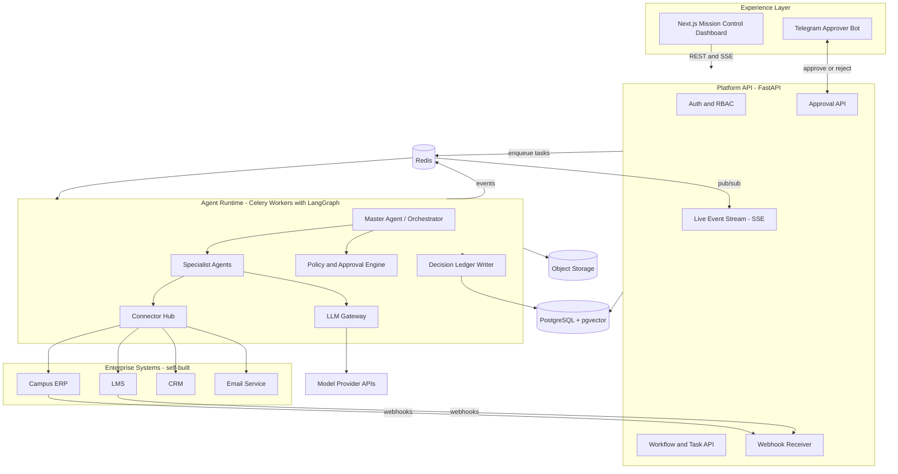
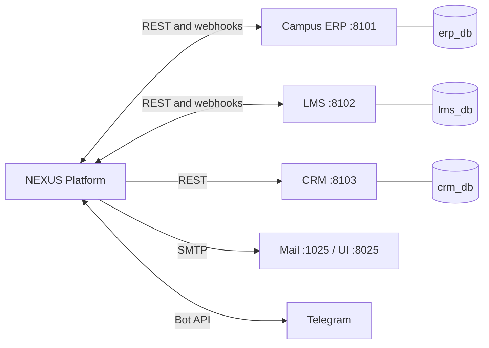
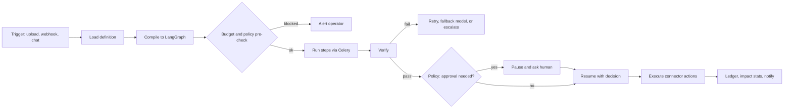
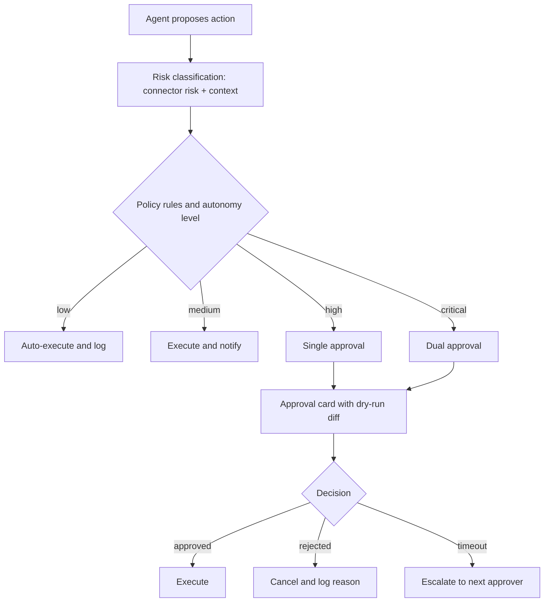
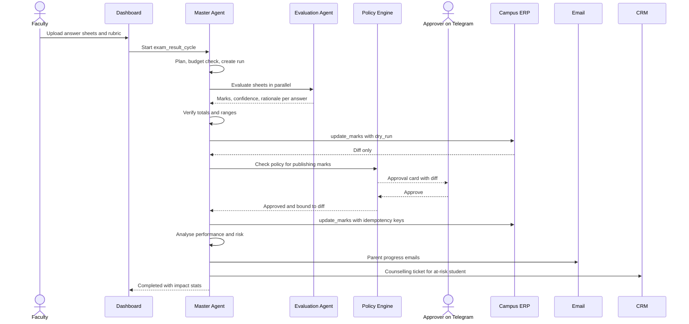

# Veyronica: Agentic AI Workflow Automation Platform

> **Agents that run the workflow. Humans who stay in control. A ledger that proves everything.**

Veyronica is an agentic AI platform that automates complete business workflows across connected enterprise systems (ERP, LMS, CRM, email, databases). Intelligent agents understand a task, plan it, decide, and execute it across systems. A policy-driven human-in-the-loop layer keeps sensitive decisions under human control, and a tamper-evident decision ledger records every action, decision and outcome. Our first deployment is **NEXUS Campus**, an education management pack, and the same core runs other business processes (HR leave approval, invoice approval) from configuration alone.

---

## Table of Contents

1. [Executive Summary](#1-executive-summary)
2. [Problem Statement to Solution Mapping](#2-problem-statement-to-solution-mapping)
3. [Product Concept: Core Platform plus Packs](#3-product-concept-core-platform-plus-packs)
4. [System Architecture](#4-system-architecture)
5. [The Enterprise Ecosystem We Build](#5-the-enterprise-ecosystem-we-build)
6. [Connector Hub](#6-connector-hub)
7. [Workflow Engine](#7-workflow-engine)
8. [Agents](#8-agents)
9. [Human-in-the-Loop and Policy Engine](#9-human-in-the-loop-and-policy-engine)
10. [Decision Ledger and Audit Trail](#10-decision-ledger-and-audit-trail)
11. [Observability, Cost Governance and Impact Analytics](#11-observability-cost-governance-and-impact-analytics)
12. [LLM Gateway](#12-llm-gateway)
13. [Flagship Workflows](#13-flagship-workflows)
14. [Extensibility Proof: Other Business Processes](#14-extensibility-proof-other-business-processes)
15. [Data Model](#15-data-model)
16. [API Design](#16-api-design)
17. [Frontend: One Dashboard](#17-frontend-one-dashboard)
18. [Security, Privacy and Responsible AI](#18-security-privacy-and-responsible-ai)
19. [Deployment](#19-deployment)
20. [Repository Structure](#20-repository-structure)
21. [Demo Plan](#21-demo-plan)
22. [Build Plan and Team Split](#22-build-plan-and-team-split)
23. [Risks and Mitigations](#23-risks-and-mitigations)
24. [Judge Q&A Preparation](#24-judge-qa-preparation)
25. [Future Scope](#25-future-scope)
26. [Appendix: Code Skeletons](#26-appendix-code-skeletons)

---

## 1. Executive Summary

**The problem.** Business processes such as exam results, approvals and onboarding span several applications. Staff copy data between them by hand, which is slow and error-prone. Plain automation scripts break on unstructured inputs (handwritten sheets, free-text requests) and cannot make decisions.

**Our solution.** NEXUS puts an agent layer on top of existing systems:

1. **Understands** a task or event (an upload, a webhook, a chat request).
2. **Plans** the steps and assigns them to specialist agents, using a cheaper or stronger AI model according to difficulty.
3. **Acts** across systems through a standard connector layer.
4. **Pauses for humans** when a policy says the action is sensitive, showing the approver exactly what will change.
5. **Records** every action, decision, approval and outcome in a tamper-evident ledger.
6. **Reports** live status, token cost and measured time saved on one dashboard.

### 30-second pitch

"Today, publishing exam results means a faculty member checks sheets, types marks into the ERP, emails parents and separately tells counselling about struggling students. NEXUS runs that entire cycle across four systems by itself. A human only appears where judgment matters, approving from the dashboard or from Telegram. Every step lands in a hash-chained ledger the auditor can verify, and the same engine runs HR and finance workflows from a config file."

### Five differentiators (what judges should remember)

| # | Differentiator | Why it matters |
|---|---|---|
| 1 | **Multi-system execution** through a Connector Hub with dry-run diffs | Directly satisfies "connect two or more enterprise applications" |
| 2 | **Policy-driven approvals + Autonomy Dial** (Assist / Supervised / Autonomous) | Trust and accountability; the operator controls how much autonomy agents get |
| 3 | **Tamper-evident decision ledger** with replay and integrity verification | Goes beyond logs; "every action, decision and outcome" is provable |
| 4 | **Live Mission Control** with agent map, token budget and **measured impact** | Shows efficiency gains with numbers, not claims |
| 5 | **Workflow-as-config** with templates | Proves "extendable to many other business processes" |

### What is simulated and what is real (state this openly)

| Real | Simulated by us (and replaceable) |
|---|---|
| Agent orchestration, LangGraph state, approvals, policy engine, ledger, cost tracking, AI model calls, email delivery, Telegram approvals | Campus ERP, LMS and CRM are **self-built mock enterprise systems** with their own databases and APIs. In production, only the connector adapters change (for example Moodle, Google Classroom, HubSpot, SAP) |

---

## 2. Problem Statement to Solution Mapping

| Problem statement requirement | How NEXUS delivers it | Where judges see it |
|---|---|---|
| Intelligent agents **understand a task, take decisions, execute** without constant instruction | Master Agent plans from workflow definitions or natural language; specialist agents decide with confidence scores; Connector Hub executes | Exam workflow runs from one upload click; Copilot chat |
| **Connects two or more enterprise applications** (ERP, CRM, email, databases) | Separate Campus ERP, LMS, CRM, Email and PostgreSQL, all reached via connectors with webhooks back in | "Connected Systems" page; marks appear in the ERP, ticket appears in the CRM, email arrives |
| **Human-in-the-loop approval** for sensitive or high-value decisions | Policy engine decides when to pause; approval card shows before/after diff; approve on dashboard or Telegram; timeout and escalation | Phone approval during demo |
| **Cloud computing** and scalable deployment | Stateless API, Celery workers on queues, managed Postgres and Redis, containerised services, Vercel frontend | Architecture slide, `docker compose up` |
| **Data analytics and dashboards** | Mission Control, Impact Analytics, Token and Cost, Performance reports | Impact page with measured time saved |
| **Audit trails** recording every action, decision and outcome | Hash-chained Decision Ledger with reasoning summaries, approver identity, model used, replay | Audit Explorer, "Verify Integrity" button |
| **Reduces manual time and errors** | Baseline vs automated timing, error catch counts from the verifier | Impact page |
| **Extendable to many business processes** | Workflow YAML, agent registry, connector catalog, template gallery (HR leave, invoice approval) | Third workflow runs from config live |

---

## 3. Product Concept: Core Platform plus Packs

```
+-------------------------------------------------------------+
|  NEXUS CORE: orchestration, policy, ledger, monitoring,     |
|  LLM gateway, connector hub, workflow engine, dashboard     |
+------------------+--------------------+---------------------+
| CAMPUS PACK      | HR PACK            | FINANCE PACK        |
| (fully built)    | (template + demo)  | (template only)     |
| exam results,    | leave approval,    | invoice approval,   |
| assignments,     | onboarding         | expense checks      |
| timetable, papers|                    |                     |
| chat, security   |                    |                     |
+------------------+--------------------+---------------------+
```

### Personas

| Persona | Role in the platform |
|---|---|
| **Principal / Admin** | Configures policies, budgets and autonomy; uses Copilot; reviews audit and impact |
| **HOD / Approver** | Receives approval requests (dashboard and Telegram) |
| **Faculty** | Starts workflows (upload sheets, syllabus), reviews AI output |
| **Platform operator** | Monitors agents, cost, failures, connector health |
| **Parents / Students** | External recipients of emails; no login in version 1 |

---

## 4. System Architecture



### Component responsibilities

| Component | Responsibility |
|---|---|
| **Next.js dashboard** | Single UI for every role: workflows, approvals, monitoring, audit, chat, connected systems |
| **FastAPI** | Auth, RBAC, REST endpoints, webhook intake, SSE stream. Stays thin: it enqueues work and never runs AI itself |
| **Redis** | Celery broker, pub/sub for live events, rate limiting counters |
| **Celery workers** | Run LangGraph graphs on separate queues: `ai_heavy`, `ai_light`, `connectors`, `email`, `security` |
| **LangGraph** | Durable agent state (Postgres checkpointer), parallel fan-out, `interrupt()` for human approval, replay |
| **Policy engine** | Decides auto-run vs notify vs approve vs dual-approve for each action |
| **Connector Hub** | Typed adapters with retry, circuit breaker, idempotency and dry-run diff |
| **LLM Gateway** | Model tier routing, budget guard, caching, JSON-schema validation, usage logging |
| **Decision Ledger** | Append-only hash-chained record of actions, decisions, approvals, outcomes |
| **PostgreSQL** | Platform tables, ledger, checkpoints, vector embeddings (pgvector); each mock system has its own schema or database |
| **Object storage** | Answer sheet scans, syllabus files, generated PDFs (MinIO locally, S3 or R2 in cloud) |

### Technology stack

| Layer | Choice | Reason |
|---|---|---|
| Frontend | Next.js (App Router), Tailwind CSS, shadcn/ui, Recharts, **React Flow** (agent map), Framer Motion | Fast to build, polished look, live graph visuals |
| Backend API | Python, FastAPI, Pydantic v2, SQLAlchemy 2, Alembic | Async, typed, auto API docs for judges |
| Agent workflow | LangGraph with Postgres checkpointer | Durable state, human interrupts, replay |
| Queue | Celery + Redis | Parallel background execution, retries, scheduled jobs (beat) |
| Database | PostgreSQL 16 + pgvector | One database for relational, JSON and vector data |
| AI models | Provider-agnostic via a gateway (optionally LiteLLM); three configurable tiers | Swap models without code changes |
| Solver | Google OR-Tools CP-SAT | Deterministic timetable generation |
| Documents / OCR | PyMuPDF, vision-capable model for handwriting | Answer sheets and syllabus |
| Approvals channel | Telegram Bot API (inline Approve / Reject buttons) | Live phone approval is a strong demo moment |
| Email | Mailpit (local inbox UI) plus real SMTP or Resend for a live email to your phone | Visible, reliable email demo |
| Storage | MinIO (S3-compatible) | Same API locally and in cloud |
| Observability | Sentry (errors), structured JSON logs | Operational visibility |
| Deployment | Docker Compose; Vercel (frontend); VPS or Railway/Render/Fly.io (backend) | One command locally, simple in cloud |

---

## 5. The Enterprise Ecosystem We Build

Since real ERP access is not available, we build **small but genuinely separate enterprise applications**. Each has its own service, database, API key, web page and outbound webhooks. This is what makes "connects two or more enterprise applications" credible: the agents must cross real network and data boundaries.



### 5.1 Campus ERP (port 8101)

Student information system and results register.

| Item | Detail |
|---|---|
| Stack | FastAPI + its own Postgres database (`erp_db`) + a simple server-rendered or small React UI |
| Tables | `students`, `parents`, `divisions`, `subjects`, `faculty`, `enrollments`, `exams`, `marks`, `attendance`, `mark_history` |
| Auth | `X-API-Key` header per client |
| Key endpoints | `GET /students?division=B`, `GET /students/{id}`, `GET /exams/{id}/marks`, `POST /marks/bulk` (supports `dry_run=true`), `PATCH /marks/{id}`, `GET /attendance/summary`, `DELETE /students/{id}` (soft) |
| Webhooks out | `marks.updated`, `student.updated` |
| UI | Students list, marks register, mark history with source ("NEXUS agent" vs "manual") |

### 5.2 LMS (port 8102)

Assignment and submission system.

| Item | Detail |
|---|---|
| Stack | FastAPI + `lms_db` + simple student submission page |
| Tables | `courses`, `assignments`, `submissions`, `grades` |
| Key endpoints | `POST /assignments`, `POST /submissions` (student upload), `GET /assignments/{id}/status`, `PUT /grades/{id}` |
| Webhooks out | `assignment.submitted`, `assignment.overdue` (via scheduler) |
| UI | Course page, submission form, gradebook |

### 5.3 CRM / Counselling Desk (port 8103)

Student support and admissions follow-up, built as a CRM.

| Item | Detail |
|---|---|
| Stack | FastAPI + `crm_db` + a Kanban board UI (New, In Progress, Resolved) |
| Tables | `contacts`, `tickets`, `notes`, `activities` |
| Key endpoints | `POST /tickets`, `PATCH /tickets/{id}`, `GET /contacts/{student_ref}`, `POST /notes` |
| UI | Kanban of counselling tickets that fills up live as agents flag at-risk students |

### 5.4 Email

- **Mailpit** (SMTP on 1025, inbox UI on 8025) captures every parent email for a visible, safe demo inbox.
- A **real SMTP/Resend** path sends one email to a phone so the audience sees real delivery. Toggle by environment variable.
- Email templates (Jinja2): `assignment_submitted`, `exam_result`, `progress_report`, `security_alert`, `budget_alert`.

### 5.5 Telegram approver bot

The platform sends an approval card to the approver's Telegram with a summary, risk level and Approve / Reject buttons. A button tap calls the Approval API, which resumes the paused workflow.

### 5.6 Seed data (Faker, locale `en_IN`)

| Entity | Quantity |
|---|---|
| Divisions | 3 (A, B, C) with 60 students each |
| Subjects | 6 (including Data Structures, DBMS, OS) |
| Faculty | 8 |
| Past marks | Two prior exams for all students |
| Assignments | 4 per subject with a mix of on-time, late and missing |
| Parent emails | All point to your demo inbox (Mailpit and one real address) |

**Story characters** (scripted for the demo):

- **Riya Patel, Division B**: strong history, then a sharp drop in the new exam. She triggers the at-risk flow and the CRM ticket.
- **Karan Mehta, Division A**: a borderline answer where the AI's confidence is low. He triggers the approval pause.
- **Three late submitters** in Division C for the assignment workflow.

Provide `make seed` and `make reset` commands. Reset must restore the demo state in under 30 seconds.

### 5.7 Chaos switch (resilience demo)

Each mock system exposes `POST /_admin/chaos` with `{"mode": "outage" | "latency" | "error_rate", "duration_s": 30}`. During the demo, flip the ERP to outage mid-workflow. The platform should retry with backoff, open the circuit breaker, mark the step as degraded, queue the write, alert the operator, then complete it when the ERP recovers, with nothing lost or duplicated (idempotency keys).

---

## 6. Connector Hub

All system access goes through one abstraction. Agents never hold credentials or write SQL against external systems.

### 6.1 Connector contract

```python
class Connector(Protocol):
    name: str
    def capabilities(self) -> list[Capability]: ...      # operations, params schema, risk level
    def health(self) -> HealthStatus: ...
    def call(self, op: str, params: dict, *,
             dry_run: bool = False,
             idempotency_key: str | None = None) -> ConnectorResult: ...
```

Every write operation supports **`dry_run=True`**, which returns a structured **diff** (before and after values) without changing anything. The approval card shows this diff, so a human approves exactly what will happen.

### 6.2 Built-in behaviours

| Behaviour | Detail |
|---|---|
| Retry with exponential backoff and jitter | 3 attempts by default |
| Circuit breaker | Opens after repeated failures, half-open probe after cooldown |
| Idempotency keys | Same key never applies twice (for example `exam42:student17`) |
| Timeouts | Per operation |
| Credential vault | Secrets from environment or an encrypted table; never sent to the model |
| Schema validation | Pydantic models for params and results |
| Telemetry | Every call produces a ledger entry and a live event |

### 6.3 Connector catalog

| Connector | Operations (examples) | Risk level |
|---|---|---|
| `erp` | `get_students`, `get_marks`, `update_marks`, `soft_delete_student`, `get_attendance` | read=low, update_marks=high, delete=critical |
| `lms` | `get_submissions`, `update_grade`, `list_overdue` | read=low, grade=medium |
| `crm` | `create_ticket`, `add_note`, `get_contact` | medium |
| `email` | `send_email` | medium (parents), low (internal) |
| `db` | read-only analytic views, allowlisted | low |
| `telegram` | `send_approval_card`, `send_alert` | low |
| `storage` | `put_object`, `get_signed_url` | low |

### 6.4 Real-world swap path

The platform never calls a vendor directly. To use real systems, write an adapter implementing the same contract: `MoodleConnector`, `GoogleClassroomConnector`, `HubSpotConnector`, `ZohoConnector`, `SapConnector`. Agents, policies and workflows stay unchanged. Optionally expose connectors as **MCP (Model Context Protocol) servers** so any MCP-capable agent can use the same tools.

---
## 7. Workflow Engine

Workflows are **declarative definitions** (YAML) compiled into LangGraph graphs. This gives a deterministic, auditable skeleton (cheap, predictable) while agents handle the parts that need intelligence. It is also what makes NEXUS extensible: a new business process is a new file, not new engine code.

### 7.1 Two ways a task enters the system

| Mode | Example | How it runs |
|---|---|---|
| **Defined workflow** | "Exam Result Cycle", triggered by upload or event | Loaded from YAML, compiled to a graph, no planning tokens needed |
| **Ad-hoc request** | Chat: "Find students with 3+ late submissions and open counselling tickets" | Planner agent proposes a plan using only registered tools; the plan is validated against the connector catalog and policies before execution |

### 7.2 Step types

| Type | Purpose |
|---|---|
| `agent` | Run a specialist agent (with model tier hint) |
| `connector` | Call a connector operation (optionally `dry_run` first) |
| `approval` | Pause for a human under a named policy |
| `parallel` | Fan out over a collection (for example each answer sheet) |
| `verify` | Rule checks (schema, ranges, totals) and optional model sanity check |
| `branch` | Conditional routing (`when:` expressions) |
| `notify` | Email, Telegram or dashboard alert |

### 7.3 Example definition: Exam Result Cycle

```yaml
id: exam_result_cycle
name: Exam Result Cycle
pack: campus
trigger:
  type: manual            # or: event -> exam.sheets_uploaded
autonomy: supervised      # assist | supervised | autonomous
baseline_manual_minutes:  # measured by the team, used for impact analytics
  evaluate: 6             # per answer sheet
  enter_marks: 1.5        # per student
  email_parent: 2         # per student
  flag_counselling: 5     # per at-risk student
steps:
  - id: ingest
    type: agent
    agent: ingestion
    model_tier: small
    action: ocr_extract_answers
  - id: evaluate
    type: parallel
    over: answer_sheets
    agent: evaluation
    model_tier: strong
  - id: verify_marks
    type: verify
    checks: [marks_sum, marks_within_range, confidence_threshold]
  - id: dry_run_erp
    type: connector
    connector: erp
    op: update_marks
    dry_run: true
  - id: approve_marks
    type: approval
    policy: marks_publication
    show: dry_run_erp.diff
  - id: write_erp
    type: connector
    connector: erp
    op: update_marks
    idempotency_key: "{exam_id}:{student_id}"
  - id: analyse
    type: agent
    agent: analysis
    model_tier: medium
  - id: notify_parents
    type: connector
    connector: email
    op: send_email
    policy: parent_communication
  - id: flag_at_risk
    type: connector
    connector: crm
    op: create_ticket
    when: "student.risk_score >= 0.7"
```

### 7.4 Execution model



### 7.5 Autonomy Dial

Each workflow has an autonomy level, changeable live from the dashboard. It changes how the policy engine treats risk.

| Level | Behaviour |
|---|---|
| **Assist** | Agents prepare everything; every write needs approval |
| **Supervised** (default) | Low and medium risk run automatically; high risk needs approval; critical needs dual approval |
| **Autonomous** | Only critical actions need approval; everything else runs and is logged |

Demo moment: switch the dial from Assist to Supervised and show approvals disappearing for low-risk steps while high-risk steps still pause.

### 7.6 Durability and replay

- LangGraph checkpoints each node to Postgres. A crashed worker resumes from the last checkpoint.
- Approvals can wait hours or days because state is persisted, not held in memory.
- **Decision Replay**: the UI steps through a finished run checkpoint by checkpoint, showing inputs, outputs, and decisions at each node.

---

## 8. Agents

Agents are small, single-purpose graphs registered in an **agent registry** (name, role, tools, default model tier, enabled flag). The Master Agent coordinates them.

### 8.1 Agent catalog

| Agent | Responsibility | Tools | Model tier |
|---|---|---|---|
| **Master Agent** | Load or plan workflow, route steps, track progress, enforce budget and policy, handle failures, aggregate, verify, finalise | Registry, policy engine, ledger | Code-driven; small model for routing, strong only to plan ad-hoc tasks |
| **Ingestion Agent** | Parse uploads (PDF, scans, Excel); OCR; structure answers | Storage, OCR/vision | Small (vision when needed) |
| **Evaluation Agent** | Mark each answer against rubric; return marks, reasoning, confidence | Rubric store | Strong |
| **Analysis Agent** | Combine marks, assignments, attendance; weak topics; risk score; recommendations | ERP, LMS reads, SQL aggregates | Medium |
| **Communication Agent** | Draft parent and internal messages from approved facts | Email connector | Small |
| **Assignment Agent** | Track submissions, late and missing lists, trigger notices (mostly rule-based) | LMS, ERP, Email | None / small |
| **Timetable Agent** | Parse Excel, build constraints, run OR-Tools, explain conflicts | Solver | Small (solver does the work) |
| **Question Paper Agent** | Generate original questions from syllabus by difficulty; duplicate check | pgvector, storage | Strong |
| **Copilot Agent** | Natural-language admin requests via tool calls; charts and tables | Read tools, write tools with confirmation | Medium (strong for complex analysis) |
| **Verifier** | Validate outputs (schema, arithmetic, ranges, cross-system consistency) | Rules, cheap model check | None / small |
| **Policy Agent (engine)** | Evaluate risk and approval requirements | Policy rules | None (deterministic) |
| **Security Agent** | Detect threats from rules; summarise incidents; trigger safe responses | Login logs, rate limits | Small (summary only) |
| **Token Monitor** | Track usage, forecast, alert, enforce budget | Usage records | None (SQL and statistics) |

### 8.2 Master Agent behaviour

1. **Intake**: normalise the request into a Task with requester, role, inputs.
2. **Plan**: use a workflow definition, or a planner model constrained to registered tools.
3. **Pre-check**: budget guard and policy check for the whole plan.
4. **Dispatch**: send steps to Celery queues; independent steps run in parallel.
5. **Track**: every state change emits an event (live map) and a ledger record.
6. **Handle failures**: retry (backoff), switch model tier, switch to degraded mode (queue the action), escalate to operator.
7. **Aggregate and verify**: combine outputs and run the Verifier.
8. **Finalise**: write outcome, compute impact, notify.

### 8.3 Shared state (LangGraph)

```python
class RunState(TypedDict):
    run_id: str
    workflow_id: str
    requester: dict
    autonomy: str
    inputs: dict
    plan: list[dict]
    results: dict[str, Any]          # step_id -> output refs
    pending_approval: dict | None
    approvals: list[dict]
    errors: list[dict]
    budget: dict                     # remaining tokens/cost
    impact: dict                     # measured seconds per step
```

### 8.4 Decision records

Every agent decision is stored in structured form, not only free text:

```json
{
  "decision": "flag_for_review",
  "subject": {"type": "answer", "student_ref": "S-1042", "question": 3},
  "options_considered": ["award_full", "award_partial", "flag_for_review"],
  "chosen": "flag_for_review",
  "confidence": 0.58,
  "rationale": "Answer uses correct approach but final value differs; rubric allows partial credit; ambiguity in handwriting at step 2.",
  "inputs": {"rubric_ref": "rub_17", "answer_ref": "obj_9921"},
  "model": "tier_strong",
  "tokens": {"in": 1840, "out": 210}
}
```

The rationale is a short, structured explanation for the reviewer, not hidden chain-of-thought.

---

## 9. Human-in-the-Loop and Policy Engine

### 9.1 Design

Approval is not a per-feature screen. It is a **central policy engine** that every connector action passes through before execution.



### 9.2 Policy definitions (YAML)

```yaml
policies:
  - id: marks_publication
    applies_to: erp.update_marks
    rules:
      - when: "confidence_min < 0.75 or abs(avg_delta_pct) > 10"
        require: approval
        approver_role: faculty_head
        timeout_min: 30
        on_timeout: escalate_to:principal
      - when: "true"
        require: notify

  - id: bulk_delete
    applies_to: erp.soft_delete_student
    rules:
      - when: "true"
        require: dual_approval
        approver_roles: [admin, principal]

  - id: parent_communication
    applies_to: email.send_email
    when: "recipient_type == 'parent'"
    rules:
      - when: "template == 'progress_report'"
        require: approval
        approver_role: faculty_head
      - when: "template == 'assignment_submitted' and institution.parent_notifications"
        require: auto
```

Conditions are evaluated with a safe expression evaluator (for example `simpleeval`), never `eval`.

### 9.3 Approval card contents

| Field | Example |
|---|---|
| Title and risk badge | "Publish marks for Unit Test 2, Div B" / HIGH |
| Why approval is needed | "2 answers below confidence threshold; average change +12% vs previous exam" |
| **Exact diff** | Student, old mark, new mark, reasoning link |
| Agent confidence and model used | 0.58, tier_strong |
| Actions | Approve, Reject (reason required), Edit then approve |
| Deadline | Escalates in 30 minutes |

### 9.4 Channels

1. **Dashboard Approval Inbox**: full detail, edit marks inline.
2. **Telegram**: compact card with Approve / Reject buttons and a link to the full view. Authenticated by a linked Telegram ID mapped to a user and role.
3. **Email** (optional fallback): signed one-time links.

Approver identity, channel, time and comment are written to the ledger.

### 9.5 Rules that protect trust

- The model never decides whether approval is required; the deterministic policy engine does.
- Approvers must be a different person from the requester for critical actions.
- A rejection stops the step and records the reason; the agent may propose a revised action.
- Every approval is bound to the **exact diff shown**; if the data changes afterward, the approval is invalidated.

---

## 10. Decision Ledger and Audit Trail

### 10.1 What is recorded

Every **action, decision, approval and outcome**:

| Event type | Examples |
|---|---|
| `action` | Connector call (system, operation, params hash, result, latency) |
| `decision` | Agent decision record (options, choice, confidence, rationale) |
| `approval` | Request, approver, channel, decision, comment, timestamps |
| `outcome` | Workflow result, errors, retries, impact stats |
| `policy` | Which rule fired and why |
| `security` | Incidents and automated responses |
| `llm_call` | Model, tokens, cost, task, purpose (not the raw prompt) |

### 10.2 Tamper evidence: hash chain

Each ledger entry stores `hash = SHA256(prev_hash + canonical_json(payload))`. Altering or deleting any entry breaks every following hash.

```sql
CREATE TABLE audit_ledger (
  seq        BIGSERIAL PRIMARY KEY,
  ts         TIMESTAMPTZ NOT NULL DEFAULT now(),
  run_id     UUID,
  task_id    UUID,
  actor_type TEXT NOT NULL,          -- agent | human | system
  actor_id   TEXT NOT NULL,
  event_type TEXT NOT NULL,
  system     TEXT,
  operation  TEXT,
  payload    JSONB NOT NULL,
  prev_hash  TEXT NOT NULL,
  hash       TEXT NOT NULL UNIQUE
);
REVOKE UPDATE, DELETE ON audit_ledger FROM app_user;   -- append-only
```

**Verify Integrity** button: recomputes the chain and reports "Chain intact: N entries verified" or the first broken sequence number.

**Demo moment (rehearse it):** in a SQL console, edit one ledger row's payload, then press Verify. The UI shows the exact broken entry. (Run this as a superuser on a demo copy, not through the app role.)

### 10.3 Audit Explorer

- Filter by workflow run, agent, system, person, event type, date.
- Click a run to see a **timeline**: trigger, plan, each step, each decision, approvals, outcomes.
- Open a decision to see its record and the diff that was approved.
- Export a run as PDF or JSON for auditors.

---

## 11. Observability, Cost Governance and Impact Analytics

### 11.1 Live event stream

```
worker emits event -> Redis pub/sub -> FastAPI SSE endpoint -> dashboard
```

Event examples: `task.created`, `agent.started`, `agent.handoff`, `llm.call`, `connector.call`, `approval.requested`, `approval.decided`, `task.failed`, `task.retry`, `circuit.opened`.

> **Hosting note:** serverless functions on Vercel are not suited to long-lived streams. The browser opens SSE directly to the backend host using a short-lived token.

### 11.2 Mission Control panels

| Panel | Content |
|---|---|
| **Agent Map** | React Flow graph: Master and agents as nodes with status colours; animated edges for handoffs; click a node to see its current task |
| **Workflow Runs** | Table with status, current step, elapsed time, cost; click opens timeline |
| **Connector Health** | Per-system status, latency, circuit state, last error, chaos indicator |
| **Approval Inbox** | Pending and recent approvals with SLA timers |
| **Errors and Retries** | Failed steps, retry count, manual retry button |
| **Queue and Workers** | Queue depth per queue, worker status |

### 11.3 Token and cost governance

| Feature | Detail |
|---|---|
| Tracking | Every model call logged by agent, task, workflow, model, tokens and cost |
| Forecast | Hourly job projects month-end usage from burn rate (moving average) |
| Alerts | 50%, 80%, 95% thresholds: dashboard banner plus email to admin |
| Enforcement | At 100%: pause low-priority runs, downgrade to cheaper tier, or require admin override (configurable). Critical security tasks are exempt |
| Savings view | "Cost if every call used the strongest model" vs "actual cost", showing savings from routing and caching |

### 11.4 Impact analytics (measured, not guessed)

For each workflow run:

```
manual_estimate  = sum( baseline_minutes_per_unit x units )         # baseline measured by the team with a stopwatch
automated_time   = wall_clock_runtime
human_time       = sum( approval_wait_active_time )                 # human review is counted honestly
time_saved       = manual_estimate - automated_time - human_time
errors_prevented = verifier_failures_caught + duplicate_writes_blocked + policy_blocks
```

| Metric | Shown as |
|---|---|
| Time saved per run and cumulative | Number and trend chart |
| Manual steps removed | Count per workflow |
| Automation rate | % of steps with no human touch |
| Approval turnaround | Median minutes |
| Errors caught | Count and categories |
| Cost per run | Currency and tokens |
| Systems touched | List and counts |

> **Be honest in the demo.** Label baselines as "measured in our prototype with a stopwatch on N samples". Judges trust a modest, defensible number over a big claim.

---

## 12. LLM Gateway

Every model call goes through one module.

```
call(task_id, agent, purpose, prompt, complexity_hint, response_schema)
  1. Select tier from agent default and complexity (input size, reasoning need)
  2. Budget guard: global, workflow, agent and task limits; downgrade or refuse
  3. Cache lookup (hash of model + prompt + inputs); Demo Mode serves recorded responses
  4. PII minimiser: replace names and emails with pseudonymous IDs
  5. Provider call with timeout, retry, fallback model
  6. Validate JSON against schema; one repair retry
  7. Log usage and cost; emit event; write ledger entry
```

### Model tiers (configured in Settings, not hard-coded)

| Tier | Use for |
|---|---|
| `tier_small` | Routing, classification, extraction, formatting, email drafting |
| `tier_medium` | Analysis narratives, copilot reasoning |
| `tier_strong` | Answer marking, question generation, complex planning, vision on handwriting |

### Cost-saving tactics

- Compute in code what code can compute (totals, averages, joins, sorting).
- Send summaries and IDs, not full documents; use retrieval for syllabus context.
- JSON-schema outputs to prevent rambling.
- Cache repeated prompts and embeddings.
- Batch small items in one call where quality allows.
- Fan out many small-model calls rather than one giant strong-model call where it works.

### Demo Mode

A switch that serves **pre-recorded, validated model responses** for the scripted demo inputs. The pipeline, ledger, approvals and events still run for real; only the model call is replayed. This protects the demo against slow networks, rate limits and model variance. Keep a live-model toggle for questions from judges.

---
## 13. Flagship Workflows

Build these in priority order. **WF1 is the demo centrepiece.**

### WF1. Exam Result Cycle (cross-system: Platform, ERP, Email, CRM, Telegram)



| Step | System touched | Notes |
|---|---|---|
| 1 Upload | Storage | Sheets and rubric stored; run created |
| 2 Extract and evaluate | LLM Gateway | Vision for handwriting; parallel per sheet; strong tier |
| 3 Verify | Platform | Code recomputes totals, checks ranges, flags low confidence |
| 4 Dry-run write | ERP | Diff generated without changing data |
| 5 Approve | Policy, Telegram, Dashboard | Triggered by low confidence or large deviation |
| 6 Write marks | ERP | Idempotent; ERP shows "source: NEXUS agent" |
| 7 Analyse | ERP and LMS reads | SQL aggregates; model writes weak topics and reasons from compact facts |
| 8 Notify | Email | Parent mail with marks and recommended topics |
| 9 Flag | CRM | Ticket for students with risk score above threshold |
| 10 Record | Ledger | Every step; impact computed |

### WF2. Assignment Cycle with Parent Notifications (LMS to ERP to Email)

1. Student submits in the LMS. Webhook `assignment.submitted` reaches NEXUS.
2. Assignment Agent validates, classifies `on_time` or `late`, reads due date from the LMS.
3. Marks (if graded) sync to the ERP through a connector.
4. Policy check: if institution setting `parent_notifications` is on, send the parent email (auto); otherwise hold for approval.
5. Daily scheduled run: find overdue and repeat-late students; open a CRM ticket after N lates.
6. Ledger and impact recorded. This workflow uses almost no tokens, which supports the cost story.

### WF3. Admin Copilot (natural language over connected systems)

```
Admin message
  -> Copilot Agent (fixed tool set)
  -> read tools run at once; write tools return a confirmation request
  -> UI shows confirmation card: what, how many records, before/after diff
  -> Admin confirms -> policy engine -> connector executes -> ledger
```

| Request | Behaviour |
|---|---|
| "Show pass vs fail for the latest exam as a chart" | `get_pass_fail_counts` then bar chart |
| "Find students with 3 or more late assignments" | LMS and ERP read tools, table result |
| "Open counselling tickets for them" | Multi-step plan: CRM writes, policy check, confirmation |
| "Delete this incorrect record" | Critical risk: dual approval, soft delete, audit entry |

Rules: **no free-form SQL writes by the model**; analytics queries run on a read-only role over allowlisted views with row limits and statement timeouts; user-provided text is treated as data, never as instructions.

### WF4. Security Incident Response

| Signal | Detection (code) | Response |
|---|---|---|
| Repeated failed logins | N failures per user or IP in M minutes | Temporary lockout, alert |
| Unusual login | New device or location, odd hours | Step-up verification |
| Suspicious DB or ERP operations | Bulk deletes, mass exports, off-hours writes | Hold pending approval, alert |
| Abnormal traffic | Rate anomaly per IP or endpoint | Rate limit, temporary IP block |

Flow: rule engine detects, Security Agent gathers context, small model writes an incident summary, admin gets email, Telegram alert and dashboard incident. Only temporary, reversible actions run automatically; permanent blocks need approval. **Rules detect, AI explains, humans or fixed policies act.**

Demo script: a one-line shell loop that fires failed logins, so the incident appears on the dashboard within seconds.

### WF5. Timetable Generation (Campus pack, build if time allows)

1. Upload Excel (subjects, lectures per week, faculty, divisions, constraints).
2. Validate against a template; show row-level errors.
3. Timetable Agent translates rows into constraints; **OR-Tools CP-SAT solves**.
   - Hard: no faculty or division double-booking, exact lecture counts, room capacity.
   - Soft: balanced daily load, limit consecutive lectures, spread subjects.
4. Draft saved with a workload and conflict report; if infeasible, the exact cause is explained.
5. Faculty edits on a grid (each move re-validated) and publishes through approval policy.

### WF6. Question Paper Generation (Campus pack, build if time allows)

1. Upload syllabus; extract, chunk by unit and topic, embed in pgvector.
2. Set marks, difficulty mix (for example 30/50/20), units, Bloom levels.
3. Generate per unit in parallel with scenario and application-style prompts.
4. **Originality pipeline**: compare against the question bank by embedding similarity, regenerate near-duplicates.
5. Verifier checks coverage, marks total and difficulty distribution.
6. Faculty reviews, edits, approves; export PDF with answer key and marking scheme.

---

## 14. Extensibility Proof: Other Business Processes

This section answers "can be extended to many other business processes" with evidence. Build **at least WF-HR live in the demo** from configuration only.

### HR Leave Approval (config only)

```yaml
id: leave_request
name: Leave Request Approval
pack: hr
trigger: {type: event, event: leave.requested}
autonomy: supervised
steps:
  - id: check_balance
    type: connector
    connector: hr_db
    op: get_leave_balance
  - id: check_conflicts
    type: agent
    agent: analysis
    model_tier: small
    action: team_coverage_check
  - id: approve
    type: approval
    policy: leave_policy
  - id: update_hr
    type: connector
    connector: hr_db
    op: apply_leave
  - id: notify
    type: connector
    connector: email
    op: send_email
```

```yaml
policies:
  - id: leave_policy
    applies_to: hr_db.apply_leave
    rules:
      - when: "days <= 2 and balance_after >= 0 and coverage_ok"
        require: auto
      - when: "days > 2 or not coverage_ok"
        require: approval
        approver_role: manager
        timeout_min: 240
```

### Invoice Approval (template shown in gallery)

Steps: extract invoice fields (small vision model), match against purchase order (database connector), flag mismatches, approval above a spend threshold, post to the finance system, email the vendor.

### What to show

| Artifact | Purpose |
|---|---|
| **Template Gallery** page with Campus, HR and Finance packs | Shows the platform idea |
| HR leave run live, using the same approval, ledger, monitoring and cost tracking | Proves reuse; no new engine code |
| "Add a connector" and "Add a workflow" snippets on a slide | Shows how a new process is onboarded in hours |

---

## 15. Data Model

### 15.1 Platform database (`nexus_db`)

| Table | Key columns |
|---|---|
| `users` | id, name, email, role, telegram_id, mfa_enabled, status |
| `roles`, `permissions` | RBAC definitions |
| `agents` | id, name, role, default_tier, enabled |
| `workflow_definitions` | id, version, pack, yaml, autonomy_default, baseline_minutes jsonb |
| `workflow_runs` | id, workflow_id, trigger, status, autonomy, started_by, started_at, finished_at, impact jsonb |
| `tasks` | id, run_id, parent_task_id, step_id, agent_id, status, retries, error, started_at, finished_at |
| `task_events` | id, run_id, task_id, ts, event_type, from_agent, to_agent, payload jsonb |
| `llm_calls` | id, task_id, agent_id, model, tier, tokens_in, tokens_out, cost, latency_ms, cached bool, ts |
| `token_budgets` | scope, period, limit_tokens, limit_cost, thresholds jsonb |
| `model_tiers` | tier, provider, model_name, price_in, price_out |
| `policies` | id, version, yaml, enabled |
| `approval_requests` | id, run_id, policy_id, risk, summary, diff jsonb, diff_hash, status, requested_at, deadline, channel |
| `approval_decisions` | id, request_id, approver_id, decision, comment, channel, ts |
| `connectors` | id, name, type, config_ref, status, circuit_state, last_error |
| `connector_calls` | id, connector_id, op, params_hash, status, latency_ms, idempotency_key, ts |
| `audit_ledger` | see section 10 |
| `security_events` | id, type, severity, source_ip, user_id, details jsonb, status, ts |
| `blocked_entities` | type, value, reason, expires_at, created_by |
| `login_attempts` | user_id, ip, success, ts |
| `documents`, `chunks` | uploaded files and embeddings (pgvector) |
| `question_bank` | question, topic, difficulty, embedding |
| `notifications` | type, recipient, status, sent_at, error |

LangGraph checkpoint tables are created by its Postgres checkpointer.

### 15.2 Mock systems (separate databases)

**ERP (`erp_db`)**

```sql
CREATE TABLE students (id SERIAL PRIMARY KEY, roll_no TEXT UNIQUE, name TEXT, division TEXT,
                       parent_name TEXT, parent_email TEXT, status TEXT DEFAULT 'active');
CREATE TABLE subjects (id SERIAL PRIMARY KEY, code TEXT, name TEXT);
CREATE TABLE exams (id SERIAL PRIMARY KEY, name TEXT, subject_id INT, max_marks INT, held_on DATE);
CREATE TABLE marks (id SERIAL PRIMARY KEY, exam_id INT, student_id INT, obtained NUMERIC(5,2),
                    source TEXT, updated_at TIMESTAMPTZ DEFAULT now(), UNIQUE (exam_id, student_id));
CREATE TABLE mark_history (id SERIAL PRIMARY KEY, mark_id INT, old_value NUMERIC, new_value NUMERIC,
                           changed_by TEXT, idempotency_key TEXT UNIQUE, ts TIMESTAMPTZ DEFAULT now());
CREATE TABLE attendance (student_id INT, subject_id INT, date DATE, present BOOLEAN);
```

**LMS (`lms_db`)**: `courses`, `assignments (id, course_id, title, due_at, max_marks)`, `submissions (id, assignment_id, student_ref, submitted_at, file_ref, status)`, `grades (submission_id, marks, graded_by)`.

**CRM (`crm_db`)**: `contacts (id, student_ref, name, parent_email)`, `tickets (id, contact_id, title, priority, status, source, created_at)`, `notes (ticket_id, body, author)`, `activities`.

---

## 16. API Design

All long operations return `202 Accepted` with a `run_id`; progress arrives through SSE.

```
AUTH
  POST /auth/login | /auth/refresh | /auth/mfa/verify
WORKFLOWS
  GET  /workflows                     list definitions and templates
  GET  /workflows/{id}                definition (YAML and graph form)
  POST /workflows/{id}/run            start a run (multipart for uploads)
  PUT  /workflows/{id}/autonomy       change the autonomy dial
  GET  /runs                          list; filters
  GET  /runs/{id}                     detail with timeline
  GET  /runs/{id}/replay              checkpoints for Decision Replay
  POST /runs/{id}/retry | /cancel
APPROVALS
  GET  /approvals/inbox
  GET  /approvals/{id}                card with diff
  POST /approvals/{id}/decision       approve | reject | edit
  POST /telegram/webhook              callback from approval buttons
CONNECTORS AND SYSTEMS
  GET  /connectors                    health, circuit state
  POST /connectors/{id}/test
  POST /webhooks/{system}             inbound events (erp, lms)
POLICIES
  GET/PUT /policies
AUDIT
  GET  /audit?run_id=&actor=&type=&from=&to=
  GET  /audit/verify                  integrity check
  GET  /audit/export/{run_id}
COPILOT
  POST /chat/message
  POST /chat/confirm/{action_id}
MONITORING AND COST
  GET  /agents | /tasks | /events (SSE at /stream/events)
  GET  /usage/summary | /usage/forecast | /usage/savings
  PUT  /budgets
IMPACT
  GET  /impact/summary | /impact/by-workflow
SECURITY
  GET  /security/events | POST /security/blocks
DEMO
  POST /demo/reset | /demo/mode | /demo/chaos
```

FastAPI's auto-generated `/docs` page is a free credibility boost: show it briefly if a judge asks about the API.

---

## 17. Frontend: One Dashboard

A single Next.js application. The sidebar adapts to the user's role. A global command palette (Ctrl+K) jumps anywhere. A slide-over Copilot is available on every page.

### 17.1 Navigation

| Section | Pages |
|---|---|
| **Mission Control** | Overview, Agent Map, Live Runs |
| **Workflows** | Library and Templates, Workflow Studio (graph view of the YAML, autonomy dial), Run detail with Decision Replay |
| **Approvals** | Inbox, history, policy editor |
| **Connected Systems** | Connector health, plus embedded read-only views of ERP, LMS, CRM and Mail so judges see the other systems change **inside the same dashboard** |
| **Campus pack** | Exams and Evaluation, Assignments, Timetable, Question Papers, Student Performance, Parent Reports |
| **Copilot** | Full-screen chat with tables and charts |
| **Governance** | Audit Explorer (with Verify Integrity), Token and Cost, Impact Analytics |
| **Security** | Incidents, blocks, rules |
| **Settings** | Models and tiers, budgets, notification rules, users and roles, demo controls |

### 17.2 Key screens to polish

1. **Mission Control Overview**: live counters (runs today, approvals pending, time saved, cost today), agent map, recent events.
2. **Agent Map**: React Flow canvas. Nodes glow while working; edges animate on handoff; clicking shows the current task and model.
3. **Run detail**: vertical timeline with step cards (agent, system, tokens, duration), inline decision records, and the approval diff.
4. **Approval card**: side-by-side before/after table, risk badge, confidence, countdown, Approve / Reject / Edit.
5. **Audit Explorer**: searchable table plus a prominent **Verify Integrity** button with a green "chain intact" state.
6. **Impact Analytics**: big "time saved" number, per-workflow bars, baseline vs automated comparison.
7. **Connected Systems**: tiles with system status; chaos indicator turns amber when you inject an outage.

### 17.3 UX guidelines that win demos

- Dark theme with one accent colour; consistent spacing; large readable numbers (judges sit far from screens).
- Every state change is visible: toasts, animated status chips, live counters.
- Empty and loading states are designed (skeletons), never blank.
- Use one clear colour language: green=done, blue=running, amber=waiting for human, red=failed.
- Keep a **Presenter Mode** that hides noisy panels and enlarges fonts.
- Never navigate away during the main flow; use the slide-over and tabs.

---

## 18. Security, Privacy and Responsible AI

| Area | Measures |
|---|---|
| **AuthN / AuthZ** | JWT with refresh rotation, MFA for admins, RBAC enforced in FastAPI dependencies and again in the policy engine; least privilege per connector |
| **Secrets** | Environment or secret manager; never exposed to agents or prompts |
| **Data protection** | TLS everywhere, encryption at rest, Argon2 password hashing |
| **PII minimisation** | Pseudonymous IDs and roll numbers go to models instead of names and emails; real contact data is filled in by code after the model returns |
| **Prompt injection defence** | Uploaded documents and student text are wrapped as untrusted data; tools never act on instructions found in data; allowlisted tools only |
| **Human control** | Deterministic policy engine, diff-bound approvals, dual approval for critical actions |
| **Auditability** | Hash-chained ledger, revoked UPDATE/DELETE on the ledger table |
| **Reliability** | Idempotency keys, circuit breakers, checkpoint resume, daily backups |
| **Fairness for AI marking** | Rubric-based marking, stored rationale, confidence thresholds, faculty override tracking to measure AI vs human differences |
| **Privacy law** | Student data, including minors' data, is regulated (for example India's Digital Personal Data Protection Act, 2023): store consent flags for parent contact, honour opt-outs, minimise retention. Get legal advice before real deployment |

---
## 19. Deployment

### 19.1 Local (demo fallback and development): one command

```yaml
# docker-compose.yml (abridged)
services:
  postgres:
    image: pgvector/pgvector:pg16
    environment: { POSTGRES_PASSWORD: nexus }
    volumes: [pgdata:/var/lib/postgresql/data]
  redis:
    image: redis:7
  minio:
    image: minio/minio
    command: server /data --console-address ":9001"
  mailpit:
    image: axllent/mailpit
    ports: ["8025:8025", "1025:1025"]
  api:
    build: ./backend
    command: uvicorn app.main:app --host 0.0.0.0 --port 8000
    depends_on: [postgres, redis]
  worker_heavy:
    build: ./backend
    command: celery -A app.workers.celery_app worker -Q ai_heavy -c 4
  worker_light:
    build: ./backend
    command: celery -A app.workers.celery_app worker -Q ai_light,connectors,email,security -c 8
  beat:
    build: ./backend
    command: celery -A app.workers.celery_app beat
  erp:
    build: ./mock-systems/erp
    ports: ["8101:8101"]
  lms:
    build: ./mock-systems/lms
    ports: ["8102:8102"]
  crm:
    build: ./mock-systems/crm
    ports: ["8103:8103"]
  web:
    build: ./frontend
    ports: ["3000:3000"]
volumes: { pgdata: {} }
```

`make up`, `make seed`, `make reset`, `make demo` should each be a single command.

### 19.2 Cloud topology

| Component | Host | Notes |
|---|---|---|
| Next.js dashboard | Vercel | `NEXT_PUBLIC_API_URL` points to the backend |
| FastAPI + workers + beat + mock systems | One VPS with Docker Compose (simplest and most reliable), or Railway / Render / Fly.io / AWS | Needs long-lived connections for SSE; put a reverse proxy (Caddy or Nginx) with HTTPS in front |
| PostgreSQL | Managed (Neon, Supabase, RDS) or the VPS container | Enable pgvector; daily backup |
| Redis | Managed (Redis Cloud, ElastiCache) or VPS container | Confirm Celery compatibility if using a serverless Redis |
| Object storage | S3, Cloudflare R2 or MinIO | Signed URLs |
| Email | Mailpit (demo inbox) plus Resend, SES or SMTP for one real email | Verified sender |
| Errors | Sentry | Free tier is enough |

**Scaling story for judges:** stateless API behind a load balancer; workers scale horizontally per queue; Postgres read replica for analytics; connectors are isolated with circuit breakers; LangGraph checkpoints make workers disposable.

### 19.3 Environment variables (examples)

```
DATABASE_URL, REDIS_URL, JWT_SECRET
LLM_PROVIDER_API_KEY, TIER_SMALL_MODEL, TIER_MEDIUM_MODEL, TIER_STRONG_MODEL
DEMO_MODE=true|false
ERP_URL, ERP_API_KEY, LMS_URL, LMS_API_KEY, CRM_URL, CRM_API_KEY
SMTP_HOST, SMTP_PORT, SMTP_USER, SMTP_PASS, REAL_EMAIL_ENABLED
TELEGRAM_BOT_TOKEN, TELEGRAM_WEBHOOK_SECRET
S3_ENDPOINT, S3_BUCKET, S3_KEY, S3_SECRET
```

---

## 20. Repository Structure

```
nexus/
  README.md
  project.md                      <- this file
  docker-compose.yml
  Makefile
  frontend/                       Next.js app
    app/(dashboard)/
      overview/ agents/ runs/[id]/ workflows/ approvals/ systems/
      campus/{exams,assignments,timetable,papers,performance,reports}/
      copilot/ audit/ usage/ impact/ security/ settings/
    components/ (AgentMap, ApprovalCard, DiffTable, Timeline, ImpactCards ...)
    lib/ (api.ts, sse.ts, auth.ts)
  backend/
    app/
      api/                        routers per module
      core/                       config, auth, rbac, middleware
      db/                         models, Alembic migrations
      engine/
        compiler.py               YAML -> LangGraph
        runner.py                 Celery entry points
        state.py                  RunState
      agents/
        master/ ingestion/ evaluation/ analysis/ communication/
        assignment/ timetable/ papers/ copilot/ verifier/ security/ tokens/
      policy/                     engine.py, rules loader, risk classifier
      connectors/                 base.py, erp.py, lms.py, crm.py, email.py, telegram.py, storage.py
      ledger/                     writer.py, verify.py
      llm/                        gateway.py, router.py, pricing.py, cache.py, demo_replay.py
      events/                     emitter.py, pubsub.py
      workers/                    celery_app.py, beat_schedule.py
    workflows/                    exam_result_cycle.yaml, assignment_cycle.yaml, leave_request.yaml ...
    policies/                     default_policies.yaml
    tests/
  mock-systems/
    erp/ lms/ crm/                each a small FastAPI service with its own DB and UI
    seed/                         Faker scripts, story characters, sample answer sheet scans
  demo/
    script.md                     the timed demo script
    recorded_llm_responses/       for Demo Mode
    backup_video.mp4
```

---

## 21. Demo Plan

> The goal is not to show every feature. It is to tell **one story**: "an exam result cycle across four systems, with humans only where it matters, and proof of everything."

### 21.1 Stage setup (checklist)

- [ ] Laptop running full stack locally **and** cloud deployment ready as a second option
- [ ] Phone hotspot as backup network
- [ ] Screen layout: Dashboard (main), ERP, CRM and Mailpit in separate tabs (also embedded in Connected Systems)
- [ ] Phone with Telegram open, mirrored or held up to the camera
- [ ] Demo Mode **on**; `make reset` run just before presenting
- [ ] Sample files ready on the desktop: 5 answer sheets, rubric
- [ ] Backup video recorded and ready
- [ ] Presenter Mode enabled
- [ ] Two team members: one presents, one handles the phone and fallback

### 21.2 Seven-minute script

| Time | What you do | What the judges see | Line to say |
|---|---|---|---|
| 0:00 | Hook | Slide: a single sentence and a manual-process photo or diagram | "Publishing results touches four systems and four people. We made it run itself, with humans only for decisions." |
| 0:40 | **Connected Systems** page | ERP, LMS, CRM, Mail all green; each opens in its own window | "These are four separate applications with their own databases. NEXUS connects to them through standard connectors." |
| 1:10 | Upload answer sheets, press **Run** | Agent Map lights up; Master plan appears; tokens and cost tick | "The Master Agent plans, picks cheap or strong models per task, and fans work out in parallel." |
| 2:00 | Show evaluation output | Marks, confidence, rationale; Karan Mehta's answer flagged | "The agent knows when it is unsure. It flagged this answer instead of guessing." |
| 2:30 | **Approval on phone** | Telegram card with exact before/after diff; tap Approve | "Policy, not the model, decided a human is required. The approver sees exactly what will change." |
| 3:15 | Switch to ERP tab | Marks changed; history says "source: NEXUS agent" | "Written to a different system, safely, with idempotency." |
| 3:40 | Mailpit and real phone email | Parent email arrives | "Parents are informed automatically, only after approval." |
| 4:00 | CRM tab | Counselling ticket for Riya Patel appears on the board | "The agent noticed a drop from 78 to 41 and opened a ticket in a third system." |
| 4:20 | **Chaos switch**: ERP outage on a second run | Connector Health turns amber; retries; circuit opens; later recovers; no duplicates | "Real systems fail. The platform retries, queues and recovers without losing or duplicating data." |
| 5:00 | **Audit Explorer**: open the run, open a decision, press **Verify Integrity** | Timeline, decision record, green "chain intact" | "Every action, decision and approval is hash-chained." |
| 5:20 | Optional: tamper demo | Edited row makes Verify point to the exact broken entry | "Nobody can change history without detection." |
| 5:45 | **Impact Analytics** and **Token and Cost** | Time saved, steps removed, cost vs strongest-model-only | "Measured in our prototype: X minutes saved per run, at Y cost." |
| 6:10 | **Autonomy Dial** | Flip Supervised to Autonomous; show which approvals disappear | "The institution decides how much autonomy to grant." |
| 6:30 | **HR Leave workflow** from Template Gallery | Runs with the same engine, approvals, ledger | "Different business process, zero engine changes: it is a config file." |
| 6:50 | Closing | Architecture slide | "Agents that act, humans in control, proof of everything, extensible to any process." |

**Optional 60-second extras** (use if time or questions allow): Copilot chart and a delete request that triggers dual approval; the security failed-login burst producing an incident.

### 21.3 Making the demo reliable

1. **Demo Mode** with recorded model responses for scripted inputs; the real pipeline still runs.
2. **One-click Reset** (`POST /demo/reset`) restoring all databases to seed state in under 30 seconds.
3. **Pre-warmed** containers and a **pre-run** of the full flow 10 minutes before judging.
4. **Offline-capable**: everything runs locally if the venue network fails.
5. **Backup video** of the full run, with voice-over.
6. **Scripted inputs only** for the main flow; ad-hoc live questions use the live-model toggle.
7. **Rehearse 10+ full runs**, including the chaos moment and phone approval timing.
8. **Fallback for Telegram**: the same approval can be given from the dashboard Inbox.

### 21.4 Mapping to likely judging criteria

| Criterion | Evidence in the demo |
|---|---|
| Innovation | Autonomy Dial, diff-bound approvals, hash-chained ledger, decision replay |
| Technical depth | LangGraph durability, Celery queues, connectors with circuit breakers, policy engine, OR-Tools solver |
| Problem fit | Multi-system, HITL, audit, dashboards, extensibility, each mapped in section 2 |
| Practical impact | Measured time saved, errors caught, cost per run |
| Scalability | Stateless API, queues, horizontal workers, managed services |
| UI/UX | Mission Control, live agent map, clean approval cards |
| Responsible AI | Confidence thresholds, human approval, PII minimisation, audit |
| Presentation | One clear story, live proof in other systems, honest numbers |

### 21.5 Slide outline (8 slides)

1. Problem: manual, multi-system, error-prone workflows
2. Solution: NEXUS in one sentence plus the five differentiators
3. Architecture diagram
4. How it decides: agents, policy engine, autonomy dial
5. Trust: HITL, ledger, replay
6. Results: measured impact and cost governance
7. Extensibility: Campus, HR, Finance packs; connector swap path
8. Roadmap and closing

---

## 22. Build Plan and Team Split

### 22.1 Priorities (MoSCoW)

| Priority | Items |
|---|---|
| **Must** | Mock ERP, CRM, LMS (basic) and Mailpit; Connector Hub with dry-run; workflow engine (YAML to LangGraph); Master Agent; Evaluation flow (WF1); policy engine with approvals (dashboard and Telegram); Decision Ledger with Verify; live Agent Map; Impact and Cost panels; Demo Mode and Reset |
| **Should** | Autonomy Dial; chaos switch and circuit breaker; WF2 assignments; Copilot with confirmation; Decision Replay; HR template run; Connected Systems embeds |
| **Could** | Security Agent and incident flow; Timetable (OR-Tools); Question Papers; budget forecasting and alerts; PDF export of audit |
| **Won't (for hackathon)** | Real ERP integrations, multi-tenant admin, mobile app, student login |

### 22.2 Team split (4 people; merge roles for 3)

| Role | Owns |
|---|---|
| **A: Agent and engine lead** | Workflow compiler, Master Agent, LangGraph state, Evaluation and Analysis agents, LLM Gateway, Demo Mode |
| **B: Systems and connectors** | Mock ERP, LMS, CRM, seed data, Connector Hub, chaos switch, webhooks, email, Telegram bot |
| **C: Frontend** | Next.js dashboard, Agent Map, approval card, audit explorer, impact pages, Presenter Mode |
| **D: Platform, policy and demo** | Policy engine, ledger and verification, SSE and events, auth and RBAC, Docker and deployment, demo script, slides, rehearsal |

### 22.3 Seven-day plan

| Day | Goals | Exit check |
|---|---|---|
| **1** | Repo, Docker Compose, database schemas, mock ERP and CRM with seed data, FastAPI skeleton, dashboard shell, auth | `make up` runs; ERP and CRM UIs show seed data |
| **2** | Connector Hub (ERP, CRM, email) with dry-run and idempotency; LLM Gateway with tiers and logging; Celery wiring; event emitter and SSE | A script can write marks to the ERP through the connector with a dry-run diff |
| **3** | Workflow compiler, Master Agent, Evaluation agent with sample sheets; LangGraph checkpoints; WF1 up to ERP write (no approval yet) | WF1 runs end to end from CLI |
| **4** | Policy engine, approval requests, dashboard Inbox, Telegram bot, `interrupt()` and resume; ledger with hash chain | Approval pauses and resumes; ledger verifies |
| **5** | Mission Control UI: Agent Map, run timeline, audit explorer, impact and cost panels; communication and CRM steps; LMS and WF2 | Full WF1 visible in the UI with all systems updating |
| **6** | Chaos switch and circuit breaker; Autonomy Dial; Copilot; HR template; Demo Mode recordings; Reset; polish | Whole 7-minute script runs |
| **7** | Rehearsals (10+), bug fixes only, backup video, slides, cloud deployment check, load the fallback | Two clean consecutive rehearsals |

### 22.4 If you have only 3 to 4 days

Cut to the **Minimum Winning Demo**:

1. Mock ERP and CRM plus Mailpit (skip LMS; simulate assignments through ERP data).
2. Connector Hub with dry-run.
3. Hard-coded YAML loader for one workflow (WF1).
4. Policy engine with one approval rule, dashboard Inbox and Telegram.
5. Ledger with Verify.
6. Agent Map, run timeline, impact page.
7. Demo Mode and Reset.

Skip: timetable, question papers, security agent, forecasting, replay UI. Add the HR template only if everything else is solid.

### 22.5 Definition of done for the demo

- The 7-minute script runs three times in a row with no manual fixes.
- Every number on the Impact page is traceable to a recorded baseline or a database query.
- The fallback (local stack, backup video, dashboard-only approval) has been tested.

---

## 23. Risks and Mitigations

| Risk | Likelihood | Mitigation |
|---|---|---|
| Model slow, rate-limited or inconsistent during demo | High | Demo Mode with recorded responses; local fallback; small and cached calls |
| Handwriting OCR errors | Medium | Use clean sample sheets for the demo; confidence flagging is itself part of the story |
| Venue network failure | Medium | Local Docker stack; phone hotspot; backup video |
| Telegram delay | Medium | Same approval available in dashboard; test webhook beforehand; use polling fallback |
| Scope too large for time | High | MoSCoW list; Minimum Winning Demo; freeze features on day 6 |
| Mock systems seen as "fake" | Medium | State openly they simulate real systems; show the connector contract and swap path; keep them visibly independent |
| Concurrency bugs in ledger | Medium | Use a Postgres advisory lock when appending; test with parallel runs |
| Judges question accuracy of impact numbers | Medium | Show baseline method and sample size; present conservative numbers |
| LangGraph or library version changes | Low | Pin versions; test resume after restart |
| Secrets leaked in repo | Low | `.env` ignored; scan before publishing |

---

## 24. Judge Q&A Preparation

| Question | Answer outline |
|---|---|
| **Are these real ERP systems?** | No. We built independent mock systems with their own databases, APIs and webhooks, because institutional ERPs are closed. The platform talks to them only through a connector contract; real systems need only a new adapter. |
| **Why agents instead of RPA or scripts?** | Inputs are unstructured (handwriting, free text); steps need judgment with confidence; plans can adapt. But we keep deterministic code for everything that can be deterministic. |
| **What if the AI is wrong?** | Verifier checks, confidence thresholds, deterministic policy, diff-bound human approval, override tracking, full audit. |
| **Who decides when a human is needed?** | A deterministic policy engine, not the model. Operators set policies and the autonomy level. |
| **How do you prevent tampering with the audit trail?** | Append-only table, revoked update and delete rights, hash chain with a verification endpoint. |
| **How do you control cost?** | Model tiering, caching, code for arithmetic, budget guard with forecasts and enforcement; the savings view shows actual vs strongest-model-only. |
| **How does it scale?** | Stateless API, queue-based workers per queue, managed Postgres and Redis, checkpointed state so workers are disposable. |
| **How is data privacy handled?** | Pseudonymous IDs to models, consent flags, RBAC, encryption, retention rules; legal review needed before real deployment. |
| **What about prompt injection?** | Uploaded content is untrusted data; allowlisted tools; policy check on every action regardless of what the model says. |
| **How is this extensible?** | Workflows and policies are YAML; agents registered in a registry; connectors implement one interface; the HR demo proves it. |
| **What is the business impact?** | Measured time saved per run and errors caught, scaled to institution volume; show the formula and baseline. |
| **What would you build next?** | Real adapters (Moodle, Google Classroom, HubSpot), multi-tenancy, workflow builder UI, MCP connector marketplace. |

---

## 25. Future Scope

- Visual **workflow builder** (drag and drop) producing the same YAML.
- **Connector marketplace** and MCP servers for third-party tools.
- **Multi-tenant** deployment with per-institution policies and budgets.
- **Learning from overrides**: use faculty corrections to improve prompts and thresholds (with review).
- **Predictive analytics**: early dropout and risk models from attendance, marks and engagement.
- **Student and parent portals** with consent management.
- **Compliance packs**: retention schedules, subject-access exports, regional privacy rules.
- **Simulation mode**: dry-run a workflow against a copy of data to preview impact before enabling autonomy.
- Additional packs: HR onboarding, procurement, customer support, finance close.

---
## 26. Appendix: Code Skeletons

These are starting points to speed up the build. Names and library versions may need small adjustments.

### 26.1 Connector base and ERP adapter

```python
# backend/app/connectors/base.py
from dataclasses import dataclass
from typing import Any, Protocol

@dataclass
class ConnectorResult:
    ok: bool
    data: Any = None
    diff: list[dict] | None = None      # populated on dry_run
    error: str | None = None
    latency_ms: int = 0

class Connector(Protocol):
    name: str
    def health(self) -> dict: ...
    def call(self, op: str, params: dict, *, dry_run: bool = False,
             idempotency_key: str | None = None) -> ConnectorResult: ...
```

```python
# backend/app/connectors/erp.py
import time, httpx
from tenacity import retry, stop_after_attempt, wait_exponential_jitter
from .base import ConnectorResult
from .breaker import CircuitBreaker

class ErpConnector:
    name = "erp"
    def __init__(self, base_url: str, api_key: str):
        self.client = httpx.Client(base_url=base_url, headers={"X-API-Key": api_key}, timeout=8)
        self.breaker = CircuitBreaker(fail_max=3, reset_s=15)

    def health(self):
        try:
            return {"status": "up", "circuit": self.breaker.state} if self.client.get("/health").is_success \
                   else {"status": "down", "circuit": self.breaker.state}
        except Exception as e:
            return {"status": "down", "error": str(e), "circuit": self.breaker.state}

    @retry(stop=stop_after_attempt(3), wait=wait_exponential_jitter(initial=0.5, max=4), reraise=True)
    def _post(self, path, json, headers):
        r = self.client.post(path, json=json, headers=headers)
        r.raise_for_status()
        return r.json()

    def call(self, op, params, *, dry_run=False, idempotency_key=None):
        t0 = time.time()
        if not self.breaker.allow():
            return ConnectorResult(ok=False, error="circuit_open")
        try:
            if op == "update_marks":
                headers = {"Idempotency-Key": idempotency_key} if idempotency_key else {}
                body = {**params, "dry_run": dry_run}
                data = self._post("/marks/bulk", body, headers)
                self.breaker.success()
                return ConnectorResult(ok=True, data=data, diff=data.get("diff"),
                                       latency_ms=int((time.time() - t0) * 1000))
            raise ValueError(f"unknown op {op}")
        except Exception as e:
            self.breaker.failure()
            return ConnectorResult(ok=False, error=str(e), latency_ms=int((time.time() - t0) * 1000))
```

### 26.2 Policy engine

```python
# backend/app/policy/engine.py
from simpleeval import SimpleEval
import yaml

RISK_ORDER = ["low", "medium", "high", "critical"]

AUTONOMY_FLOOR = {          # minimum risk level that needs approval
    "assist": "low",
    "supervised": "high",
    "autonomous": "critical",
}

def evaluate(action: str, ctx: dict, autonomy: str, policies: list[dict], connector_risk: str) -> dict:
    ev = SimpleEval(names=ctx, functions={"abs": abs, "min": min, "max": max})
    decision = {"require": "auto", "approver_role": None, "timeout_min": None,
                "rule": None, "reason": "default by risk and autonomy"}

    # 1. baseline from risk and autonomy dial
    if RISK_ORDER.index(connector_risk) >= RISK_ORDER.index(AUTONOMY_FLOOR[autonomy]):
        decision["require"] = "dual_approval" if connector_risk == "critical" else "approval"

    # 2. explicit policies can only raise strictness or relax within allowed bounds
    for p in policies:
        if p["applies_to"] != action:
            continue
        for rule in p["rules"]:
            if ev.eval(rule["when"]):
                decision.update({"require": rule["require"],
                                 "approver_role": rule.get("approver_role"),
                                 "timeout_min": rule.get("timeout_min"),
                                 "rule": f'{p["id"]}', "reason": rule["when"]})
                break
    return decision
```

> Add a guard so a policy rule can never lower a `critical` action below `dual_approval`.

### 26.3 Hash-chained ledger

```python
# backend/app/ledger/writer.py
import hashlib, json
from sqlalchemy import text

LEDGER_LOCK_ID = 727001

def canonical(payload: dict) -> str:
    return json.dumps(payload, sort_keys=True, separators=(",", ":"), default=str)

def append(db, *, run_id, task_id, actor_type, actor_id, event_type, system, operation, payload: dict):
    db.execute(text("SELECT pg_advisory_xact_lock(:k)"), {"k": LEDGER_LOCK_ID})   # serialise appends
    prev = db.execute(text("SELECT hash FROM audit_ledger ORDER BY seq DESC LIMIT 1")).scalar() or "GENESIS"
    h = hashlib.sha256((prev + canonical(payload)).encode()).hexdigest()
    db.execute(text("""
        INSERT INTO audit_ledger (run_id, task_id, actor_type, actor_id, event_type,
                                  system, operation, payload, prev_hash, hash)
        VALUES (:run_id, :task_id, :at, :ai, :et, :sys, :op, CAST(:payload AS jsonb), :prev, :hash)
    """), dict(run_id=run_id, task_id=task_id, at=actor_type, ai=actor_id, et=event_type,
               sys=system, op=operation, payload=canonical(payload), prev=prev, hash=h))
    return h
```

```python
# backend/app/ledger/verify.py
def verify_chain(db):
    rows = db.execute(text("SELECT seq, payload, prev_hash, hash FROM audit_ledger ORDER BY seq")).all()
    prev = "GENESIS"
    for seq, payload, prev_hash, h in rows:
        expected = hashlib.sha256((prev + canonical(payload)).encode()).hexdigest()
        if prev_hash != prev or h != expected:
            return {"intact": False, "broken_at": seq, "checked": seq}
        prev = h
    return {"intact": True, "checked": len(rows)}
```

Store numeric values in payloads as strings or integers (avoid float round-trip differences) so recomputation matches.

### 26.4 LLM Gateway

```python
# backend/app/llm/gateway.py
import hashlib, json, time
from pydantic import BaseModel, ValidationError

class LLMResult(BaseModel):
    data: dict
    tokens_in: int
    tokens_out: int
    cost: float
    model: str
    cached: bool = False

def call(*, task_id, agent, purpose, prompt, schema: type[BaseModel],
         tier_hint="small", complexity=0.3, db, cfg, provider) -> LLMResult:
    tier = pick_tier(agent, tier_hint, complexity, cfg)
    guard = budget_guard(db, task_id, agent, tier)          # may downgrade or raise BudgetExceeded
    tier = guard.tier

    key = hashlib.sha256(f"{tier}|{prompt}".encode()).hexdigest()
    if cfg.demo_mode and (rec := load_recorded(key)):
        return log_and_return(db, task_id, agent, purpose, rec, cached=True)
    if (hit := cache_get(key)):
        return log_and_return(db, task_id, agent, purpose, hit, cached=True)

    safe_prompt = pseudonymise(prompt)                       # swap names/emails for IDs
    for attempt in range(2):
        t0 = time.time()
        raw = provider.complete(model=cfg.tiers[tier].model, prompt=safe_prompt,
                                json_schema=schema.model_json_schema(), timeout=30)
        try:
            data = schema.model_validate_json(raw.text).model_dump()
            break
        except ValidationError:
            safe_prompt += "\nReturn valid JSON matching the schema only."
    else:
        raise RuntimeError("schema validation failed")
    res = LLMResult(data=data, tokens_in=raw.tokens_in, tokens_out=raw.tokens_out,
                    cost=price(cfg, tier, raw), model=cfg.tiers[tier].model)
    cache_put(key, res)
    return log_and_return(db, task_id, agent, purpose, res, cached=False)
```

### 26.5 LangGraph Master graph with human approval

```python
# backend/app/engine/compiler.py
from langgraph.graph import StateGraph, START, END
from langgraph.types import interrupt, Command
from langgraph.checkpoint.postgres import PostgresSaver

def approval_node(state: RunState):
    req = policy_check(state)                   # returns None if not needed
    if req is None:
        return {}
    save_approval_request(state["run_id"], req)  # persists card + diff hash
    notify_approvers(req)                        # Telegram + dashboard event
    decision = interrupt({"kind": "approval", "request_id": req["id"]})   # graph pauses here
    ledger_approval(state, req, decision)
    if not decision["approved"]:
        return {"errors": [{"step": "approval", "reason": decision.get("comment")}],
                "pending_approval": None}
    assert decision["diff_hash"] == req["diff_hash"], "data changed since approval"
    return {"approvals": state["approvals"] + [decision], "pending_approval": None}

def build_graph(defn: dict, saver):
    g = StateGraph(RunState)
    prev = START
    for step in defn["steps"]:
        node = make_node(step)                  # agent | connector | verify | approval ...
        g.add_node(step["id"], node)
        g.add_edge(prev, step["id"])
        prev = step["id"]
    g.add_edge(prev, END)
    return g.compile(checkpointer=saver)

# Start (inside a Celery task)
def run_workflow(run_id, defn, inputs):
    with PostgresSaver.from_conn_string(DB_URL) as saver:
        saver.setup()
        graph = build_graph(defn, saver)
        cfg = {"configurable": {"thread_id": run_id}}
        graph.invoke({"run_id": run_id, "inputs": inputs, "approvals": [], "errors": []}, cfg)

# Resume (called by the Approval API when a human decides)
def resume_workflow(run_id, decision: dict):
    with PostgresSaver.from_conn_string(DB_URL) as saver:
        graph = build_graph(load_definition(run_id), saver)
        graph.invoke(Command(resume=decision), {"configurable": {"thread_id": run_id}})
```

Use `when:` conditions and the `branch` step type to add conditional edges (for example the CRM ticket only when the risk score is above the threshold). For `parallel` steps, use LangGraph's `Send` API or fan out as Celery sub-tasks and join.

### 26.6 Celery task and SSE endpoint

```python
# backend/app/workers/tasks.py
@celery_app.task(bind=True, queue="ai_heavy", autoretry_for=(TransientError,),
                 retry_backoff=True, max_retries=3)
def run_workflow_task(self, run_id, workflow_id, inputs):
    emit(run_id, "task.started", {"workflow": workflow_id})
    try:
        run_workflow(run_id, load_definition_by_id(workflow_id), inputs)
        emit(run_id, "task.completed", {})
    except BudgetExceeded as e:
        emit(run_id, "task.blocked", {"reason": str(e)})
    except Exception as e:
        emit(run_id, "task.failed", {"error": str(e)})
        raise
```

```python
# backend/app/api/stream.py
from fastapi import APIRouter, Depends
from sse_starlette.sse import EventSourceResponse
import redis.asyncio as aioredis

router = APIRouter()

@router.get("/stream/events")
async def stream(user=Depends(auth_from_query_token)):
    r = aioredis.from_url(REDIS_URL)
    pubsub = r.pubsub()
    await pubsub.subscribe("nexus.events")

    async def gen():
        async for msg in pubsub.listen():
            if msg["type"] == "message":
                yield {"event": "nexus", "data": msg["data"].decode()}
    return EventSourceResponse(gen())
```

### 26.7 Frontend SSE hook

```ts
// frontend/lib/sse.ts
import { useEffect, useState } from "react";

export function useNexusEvents(token: string) {
  const [events, setEvents] = useState<any[]>([]);
  useEffect(() => {
    const es = new EventSource(`${process.env.NEXT_PUBLIC_API_URL}/stream/events?token=${token}`);
    es.addEventListener("nexus", (e) => {
      setEvents((prev) => [JSON.parse((e as MessageEvent).data), ...prev].slice(0, 200));
    });
    return () => es.close();
  }, [token]);
  return events;
}
```

### 26.8 Telegram approval card

```python
# backend/app/connectors/telegram.py
import httpx

def send_approval_card(chat_id: str, req: dict):
    text = (f"*Approval needed* ({req['risk'].upper()})\n"
            f"{req['summary']}\n\n"
            f"Confidence min: {req['confidence_min']:.2f}\n"
            f"Changes: {len(req['diff'])} records\n"
            f"Expires in {req['timeout_min']} min")
    keyboard = {"inline_keyboard": [[
        {"text": "Approve", "callback_data": f"approve:{req['id']}"},
        {"text": "Reject",  "callback_data": f"reject:{req['id']}"},
    ], [{"text": "Open details", "url": f"{DASHBOARD_URL}/approvals/{req['id']}"}]]}
    httpx.post(f"https://api.telegram.org/bot{BOT_TOKEN}/sendMessage",
               json={"chat_id": chat_id, "text": text,
                     "parse_mode": "Markdown", "reply_markup": keyboard})
```

The `/telegram/webhook` endpoint receives `callback_query`, maps the Telegram user ID to a platform user and role, checks they are allowed to approve this request, and then calls the same approval service as the dashboard.

### 26.9 Chaos switch in a mock system

```python
# mock-systems/erp/chaos.py
import time, random
from fastapi import Request, HTTPException

CHAOS = {"mode": None, "until": 0}

async def chaos_middleware(request: Request, call_next):
    if CHAOS["mode"] and time.time() < CHAOS["until"] and not request.url.path.startswith("/_admin"):
        if CHAOS["mode"] == "outage":
            raise HTTPException(503, "simulated outage")
        if CHAOS["mode"] == "latency":
            time.sleep(6)
        if CHAOS["mode"] == "error_rate" and random.random() < 0.5:
            raise HTTPException(500, "simulated error")
    return await call_next(request)

@app.post("/_admin/chaos")
def set_chaos(body: dict):
    CHAOS.update(mode=body.get("mode"), until=time.time() + body.get("duration_s", 30))
    return CHAOS
```

### 26.10 Impact calculation

```python
def compute_impact(run, defn):
    base = defn["baseline_manual_minutes"]
    manual = (base["evaluate"] * run.units["sheets"]
              + base["enter_marks"] * run.units["students"]
              + base["email_parent"] * run.units["emails"]
              + base["flag_counselling"] * run.units["tickets"])
    automated = run.wall_clock_minutes
    human = run.approval_active_minutes
    return {
        "manual_estimate_min": round(manual, 1),
        "automated_min": round(automated, 1),
        "human_review_min": round(human, 1),
        "time_saved_min": round(manual - automated - human, 1),
        "errors_prevented": run.verifier_catches + run.duplicates_blocked + run.policy_blocks,
        "systems_touched": sorted(run.systems),
    }
```

---

## Final Checklist

- [ ] Four independent systems running (ERP, LMS, CRM, Mail) with seed data and a reset command
- [ ] Connector Hub with dry-run diffs, idempotency and circuit breaker
- [ ] YAML workflow compiled to LangGraph with Postgres checkpoints
- [ ] Policy engine, approval cards, dashboard Inbox and Telegram
- [ ] Hash-chained ledger with Verify Integrity
- [ ] Mission Control: agent map, run timeline, connector health
- [ ] Impact Analytics with an honest baseline method
- [ ] Token and cost tracking with the savings view
- [ ] Demo Mode, Reset, backup video, local fallback
- [ ] HR leave template running on the same engine
- [ ] Ten rehearsals completed

**Build the story first, then the features. One flawless cross-system flow with proof beats ten half-working modules.**
